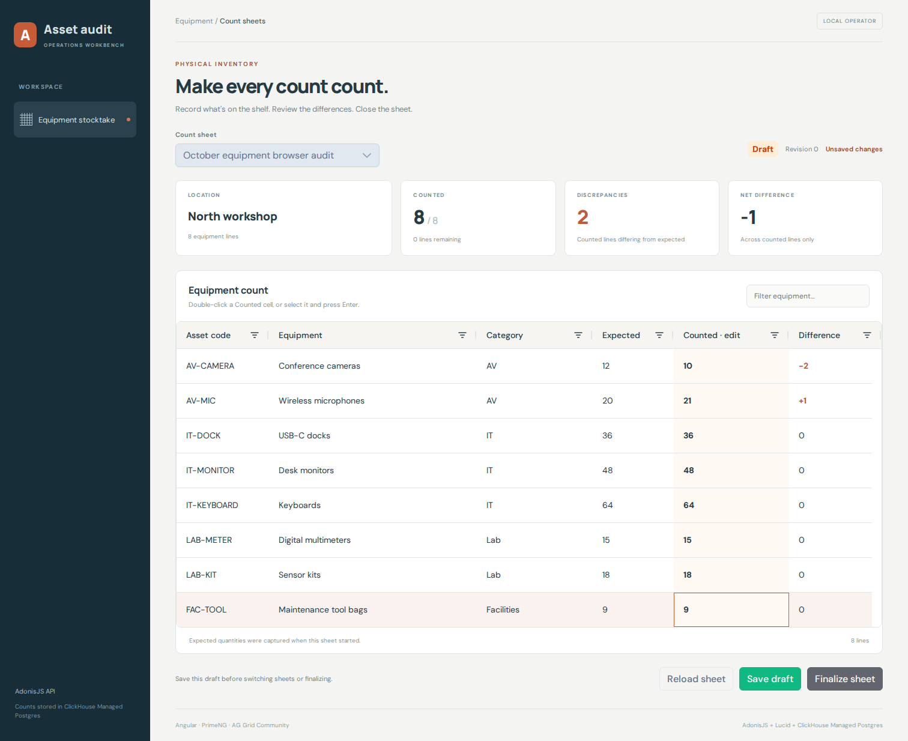
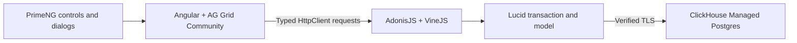

# Asset audit workbench

Count equipment with **Angular 21**, **PrimeNG**, and **AG Grid Community**, backed by an **AdonisJS** API, **Lucid ORM**, **VineJS**, and [ClickHouse Managed Postgres](https://clickhouse.com/cloud/postgres).

Open a seeded stocktake, enter quantities in the grid, review discrepancies, save a draft, and finalize the sheet. Draft saves update all submitted counts and the sheet revision in one Postgres transaction. Competing saves return a visible conflict. Finalized sheets remain readable and cannot be edited.



This is a trusted local operator workbench using synthetic equipment. It runs on loopback with same-origin mutations. It contains no user accounts, procurement workflow, or stock valuation.

## How the pieces fit



| Piece | Demonstrated behavior |
| --- | --- |
| Angular | Standalone component, signals, typed HttpClient, forms |
| AG Grid Community | Editable count cells, sorting, column filters, quick filter, derived differences |
| PrimeNG | Sheet selection, status/message components, action buttons and confirmation dialogs |
| AdonisJS and VineJS | Routes/controllers, JSON parsing and validated count payloads |
| Lucid | Migration, seeder, Stocktake model, header locks and managed transactions |
| Postgres | Quantity snapshots, constraints, revisions, atomic updates and finalization guards |

`items` describes equipment. `stocktakes` stores location, draft/finalized status and revision. `count_rows` captures expected quantities when a sheet starts, plus nullable counted quantities. An empty cell means uncounted; zero is a valid count.

The example pins Angular **21.2.25**, PrimeNG **21.1.10**, and AG Grid **36.2.0**. PrimeNG 21.1.10 is the MIT community package, without the `-lts` suffix. PrimeNG 22 uses different licensing and is not an interchangeable upgrade. Angular 21 is a supported LTS line; use the committed lockfiles. The API pins AdonisJS **7.5.2**, Lucid **22.4.2**, VineJS **4.4.0**, and pg **8.23.1**.

## Set up the example

Use Bash, Node **24.21.0**, npm 11, Git, curl, jq, OpenSSL and psql 15 or later. Install runtimes and application dependencies in Linux. On macOS, use an [isolated OrbStack machine](https://docs.orbstack.dev/machines/isolated) and copy source into its own `/home` directory.

### 1. Install dependencies and build

```sh
git clone https://github.com/ClickHouse/examples.git
cd examples/applications/asset-audit
node --version
npm ci
npm run typecheck
npm run build
```

Run these commands inside Linux. `npm ci` installs the pinned API/UI dependencies as well as the browser test runner. `npm run build` compiles Angular, compiles AdonisJS, and copies the browser build into `api/build/public`. The API serves the frontend and JSON routes on one origin.

### 2. Authenticate clickhousectl

Install [clickhousectl](https://clickhouse.com/docs/interfaces/cli) on the machine used to manage Cloud resources:

```sh
curl -fsSL https://clickhouse.com/cli | sh
export PATH="$HOME/.local/bin:$PATH"
clickhousectl --version
clickhousectl cloud auth login --interactive
clickhousectl cloud auth status
clickhousectl cloud org list
umask 077
mkdir -p .deployment
```

Creation requires an Admin API key. Enter credentials at the interactive prompt; keep them outside the application and browser. For the isolated maintainer workflow, Cloud management stays on the host and only database credentials and the CA enter the VM.

Create `.deployment/resources.env` with your organization and supported AWS region/size:

```dotenv
CH_ORG_ID=YOUR_ORGANIZATION_UUID
DEPLOYMENT_NAME=asset-audit-example
CLOUD_REGION=YOUR_AVAILABLE_AWS_REGION
PG_SIZE=YOUR_AVAILABLE_POSTGRES_SIZE
```

The recorded fixture used `us-east-1`, `c6gd.large`, Postgres 18, and no HA. Review [pricing](https://clickhouse.com/pricing) before creation. The database incurs charges until deleted; stopping the application or VM does not stop database billing.

### 3. Create the service, wait, and retrieve its CA

```sh
source .deployment/resources.env
clickhousectl cloud postgres create \
  --org-id "$CH_ORG_ID" --name "$DEPLOYMENT_NAME" \
  --provider aws --region "$CLOUD_REGION" --size "$PG_SIZE" \
  --pg-version 18 --ha-type none --tag project=asset-audit --json \
  > .deployment/postgres-create.json

PG_SERVICE_ID="$(jq -er '.id' .deployment/postgres-create.json)"
printf 'PG_SERVICE_ID=%s\n' "$PG_SERVICE_ID" >> .deployment/resources.env
```

The creation receipt includes the one-time administrator password. Keep it private. Repeat the following **get** command until `state` is `running`; do not repeat creation:

```sh
clickhousectl cloud postgres get "$PG_SERVICE_ID" \
  --org-id "$CH_ORG_ID" --json > .deployment/postgres-status.json
jq '{id, state, hostname, username, postgresVersion, size}' \
  .deployment/postgres-status.json

clickhousectl cloud postgres certs get "$PG_SERVICE_ID" \
  --org-id "$CH_ORG_ID" --output .deployment/postgres-ca.pem
```

Use the direct endpoint from your receipt, port `5432`, and database `postgres`. If creation was interrupted, reconcile the saved receipt with `clickhousectl cloud postgres list --org-id "$CH_ORG_ID" --json` before taking further action.

### 4. Bootstrap roles and migrate

Perform database setup inside Linux with the private receipt and CA available there. Generate passwords once and preserve this file on retries:

```sh
cat > .deployment/passwords.env <<PASSWORDS
PG_OWNER_PASSWORD=Aa1_$(openssl rand -hex 24)
PG_APP_PASSWORD=Aa1_$(openssl rand -hex 24)
PASSWORDS
source .deployment/passwords.env

export PGHOST="$(jq -er '.hostname' .deployment/postgres-status.json)"
export PGUSER="$(jq -er '.username' .deployment/postgres-status.json)"
export PGPORT=5432 PGDATABASE=postgres PGSSLMODE=verify-full
export PGSSLROOTCERT="$PWD/.deployment/postgres-ca.pem"
export PGPASSWORD="$(jq -er '.password' .deployment/postgres-create.json)"
export PG_OWNER_PASSWORD PG_APP_PASSWORD
psql -X -v ON_ERROR_STOP=1 -f sql/bootstrap.sql
unset PGPASSWORD
```

[bootstrap.sql](sql/bootstrap.sql) creates a dedicated schema owner/migration login and a separate runtime login. Both use the `asset_audit` schema. The owner can migrate and seed; runtime has select and narrowly scoped update grants.

Prepare migration configuration:

```sh
cat > .deployment/owner.env <<OWNER
NODE_ENV=production
HOST=127.0.0.1
PORT=3333
LOG_LEVEL=info
APP_KEY=$(openssl rand -hex 32)
APP_ORIGIN=http://127.0.0.1:3333
DB_HOST=$PGHOST
DB_PORT=5432
DB_DATABASE=postgres
DB_USER=asset_audit_owner
DB_PASSWORD=$PG_OWNER_PASSWORD
PG_CA_CERT_PATH=$PGSSLROOTCERT
OWNER

DEPLOYMENT_DIR="$PWD/.deployment"
(cd api && node --env-file="$DEPLOYMENT_DIR/owner.env" ace.js migration:run --force)
(cd api && node --env-file="$DEPLOYMENT_DIR/owner.env" ace.js db:seed)
PGUSER=asset_audit_owner PGPASSWORD="$PG_OWNER_PASSWORD" \
  psql -X -v ON_ERROR_STOP=1 -f sql/grants.sql
```

Bootstrap runs once and fails if roles already exist; its transaction rolls back on error. Lucid records applied migrations. The seeder adds missing fixtures without resetting saved counts. Resume at the failing step rather than recreating the service or roles. The example seeds two sheets, each containing eight equipment lines.

### 5. Start with runtime credentials

Copy the configuration, replacing only the database login/password in the runtime file:

```sh
sed \
  -e 's/^DB_USER=.*/DB_USER=asset_audit_app/' \
  -e "s/^DB_PASSWORD=.*/DB_PASSWORD=$PG_APP_PASSWORD/" \
  .deployment/owner.env > .deployment/app.env
chmod 600 .deployment/*.env
unset PG_OWNER_PASSWORD PG_APP_PASSWORD

set -a
source .deployment/app.env
set +a
npm start
```

Open `http://127.0.0.1:3333` in the same Linux environment. For an isolated VM, use a browser inside the VM or an SSH tunnel to its loopback port; keep the configured host and origin identical. The app rejects unrelated Host headers and mutations without its origin/custom header. The `HOST` configuration permits only loopback addresses.

[database.ts](api/config/database.ts) supplies the CA and hostname to pg through Lucid with certificate verification enabled. Database credentials use separate fields; there is no URL query string that can overwrite SSL options.

## Try the workflow

1. Open **October equipment stocktake**.
2. Double-click the camera's **Counted** cell, enter `10`, and press Enter. Expected is `12`, so its difference is `-2`.
3. Enter `21` microphones and the expected quantities for the remaining six lines. The summary shows two discrepancies and a net difference of `-1`.
4. Sort an AG Grid column or filter equipment. Filtering changes the grid display; summary cards still cover the whole sheet.
5. Click **Save draft**, then reload. The saved quantities and incremented revision return from Postgres.
6. To see a conflict, load the same sheet in two tabs. Save a change in one, then save an edit from the older tab. The second tab keeps its edits visible and asks you to reload before reapplying them.
7. Save all eight counts, click **Finalize sheet**, and confirm the PrimeNG dialog. The grid becomes read-only.

The API accepts whole counts from zero to one million, or null for uncounted. It requires every sheet item exactly once in a save payload. Finalization uses the revision the operator saw and refuses incomplete sheets. If any row update fails, the draft revision and all count changes roll back together.

## Verify changes

Inside Linux:

```sh
npm run typecheck
npm run build
npx playwright install --with-deps chromium
```

For live tests, stop the running API and use a dedicated example database. Copy `.deployment/app.env` to a separate `.deployment/test.env`, adding `TEST_OWNER_PASSWORD` with this example's schema-owner password. Keep it out of runtime configuration.

```sh
node --env-file=.deployment/test.env tests/integration.mjs
node --env-file=.deployment/test.env tests/browser.mjs
```

The tests start the real production API, create their own sheets, and remove them afterward. They check persisted counts after a genuine process restart, competing revisions, a late-row database failure, final immutability, restricted grants, and actual browser interactions. See [tests/README.md](tests/README.md) for fixture scope. The integration suite briefly adds a fixture-specific check constraint; use a dedicated schema.

The recorded managed run used PostgreSQL **18.6**. The Lucid probe succeeded with the service CA; deliberately wrong CA and hostname controls failed:

```sh
(cd api && node --env-file="$DEPLOYMENT_DIR/app.env" ace.js db:probe)
(cd api && node --env-file="$DEPLOYMENT_DIR/app.env" ace.js db:probe --servername wrong.example)
```

The second command is a deliberate failure: it resolves the same service IP and sends an incorrect TLS name. For a wrong-CA control, point `PG_CA_CERT_PATH` at an unrelated test CA and run the probe. Preserve failing controls separately from passing results.

## Scope and cleanup

The grid loads a small seeded set of equipment; it is not a large-inventory benchmark. The API uses at most five database connections per process. Finalization closes a count sheet; it does not change the source equipment quantities. The local workbench has no authentication, user identity or audit-author claim. A hosted application needs its own authentication and deployment work.

The pinned API has an unresolved upstream [braces advisory (GHSA-vfj7-8cjw-p6xm)](https://github.com/advisories/GHSA-vfj7-8cjw-p6xm). It appears in the production dependency graph through `@adonisjs/core → @adonisjs/assembler → fast-glob → micromatch → braces 3.0.3`. The application accepts no glob patterns from HTTP clients. This records dependency scope; it does not establish exploitability or a clean audit. No incompatible force downgrade was applied.

Stop the API with Ctrl-C. For a service created exclusively for this example, verify its ID against the private receipt, then delete it through clickhousectl:

```sh
source .deployment/resources.env
clickhousectl cloud postgres get "$PG_SERVICE_ID" --org-id "$CH_ORG_ID" --json
clickhousectl cloud postgres delete "$PG_SERVICE_ID" --org-id "$CH_ORG_ID"
clickhousectl cloud postgres list --org-id "$CH_ORG_ID" --json
```

Deletion removes the service and its data. Confirm that its ID is absent from the list, then remove unneeded private credential files. Keep the source, lockfiles and any evidence you want to retain.
