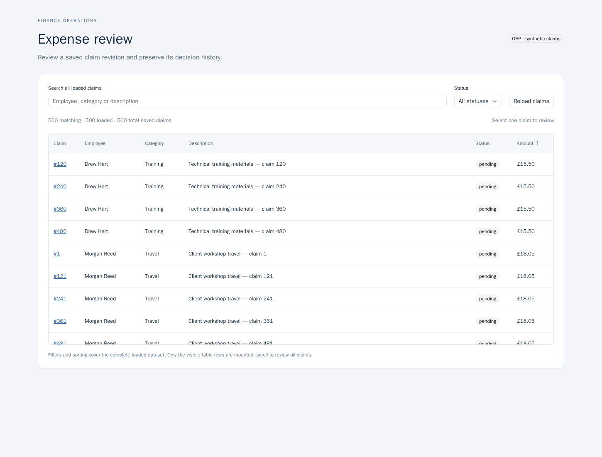
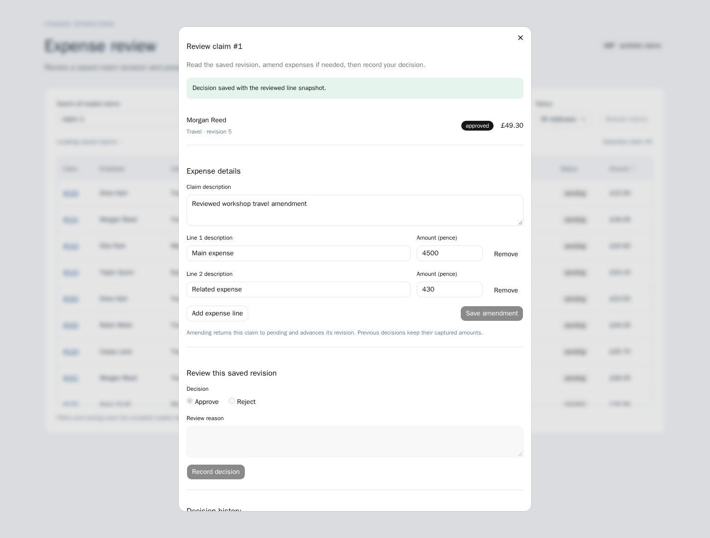

# Expense review workbench

Review a saved expense claim with **Next.js**, **shadcn/ui**, **TanStack Table 9**, **TanStack Virtual 3**, **tRPC**, **React Hook Form**, **Zod**, and ClickHouse Managed Postgres.

The complete synthetic dataset contains 500 claims and two line items per claim. TanStack Table filters, sorts and selects rows; TanStack Virtual mounts only the visible window. A shadcn dialog lets you amend actual expenses through React Hook Form or record a reasoned decision. The tRPC server derives totals in integer pence, saves amendments transactionally, and records exactly the revision, memo and lines reviewed. A later amendment returns the claim to pending while preserving earlier decision snapshots.

This is a trusted local workbench, with no sign-in, payments, file uploads or external accounting connection. All claims use GBP. Client filtering covers the complete loaded dataset; it is not a top-N query disguised as all claims. A larger real system would need server pagination/filtering.

## Linux and clickhousectl setup

Use Linux, Node 24, npm 11, psql 15+ and curl. On macOS use an [isolated OrbStack machine](https://docs.orbstack.dev/machines/isolated), with source copied into its Linux home directory. Install dependencies in Linux, not on the host.

```sh
git clone https://github.com/ClickHouse/examples.git
cd examples/applications/expense-review
npm ci
npm run check
npm run build
```

Install [clickhousectl](https://clickhouse.com/docs/concepts/features/interfaces/cli) on the machine managing Cloud resources. Creation requires an Admin API key. Enter credentials interactively, choose your organization, and keep API keys outside the app/browser. In an isolated maintainer workflow, management stays on the host; transfer only database credentials and the CA to Linux.

```sh
curl -fsSL https://clickhouse.com/cli | sh
export PATH="$HOME/.local/bin:$PATH"
clickhousectl --version
clickhousectl cloud auth login --interactive
clickhousectl cloud auth status
clickhousectl cloud org list
export ORG_ID='your-organization-id'
umask 077
mkdir -p .deployment
clickhousectl cloud postgres create --name expense-review-example \
  --region us-east-1 --size c6gd.large --provider aws \
  --pg-version 18 --ha-type none --org-id "$ORG_ID" --json > .deployment/create.private.json
export SERVICE_ID='id-from-your-create-receipt'
clickhousectl cloud postgres get "$SERVICE_ID" --org-id "$ORG_ID" --json
# Repeat get until running; do not repeat create.
clickhousectl cloud postgres certs get "$SERVICE_ID" --org-id "$ORG_ID" \
  --output .deployment/postgres-ca.pem
```

Choose a shape available to your organization. The service incurs ordinary database charges until deleted; stopping Next.js or the VM does not stop database billing. Preserve its one-time administrator credentials privately.

## Roles, schema and synthetic claims

Keep administrator, owner and runtime credentials separate. Apply the one-time SQL files to a fresh service:

```sh
export PGHOST='direct-hostname-from-receipt' PGPORT=5432 PGDATABASE=postgres
export PGSSLROOTCERT="$PWD/.deployment/postgres-ca.pem" PGSSLMODE=verify-full
export PGUSER='administrator-from-receipt' PGPASSWORD='administrator-password'
export PG_OWNER_PASSWORD='your-owner-password' PG_APP_PASSWORD='your-app-password'
psql -X -v ON_ERROR_STOP=1 -f sql/bootstrap.sql
export PGUSER=expense_review_owner PGPASSWORD="$PG_OWNER_PASSWORD"
psql -X -v ON_ERROR_STOP=1 -f sql/schema.sql
export PGUSER='administrator-from-receipt' PGPASSWORD='administrator-password'
psql -X -v ON_ERROR_STOP=1 -f sql/grants.sql
```

The runtime can read claims, lines and history, update only memo/status/revision, replace line items, and insert decisions. It cannot update/delete decision history, delete claims or create schema objects. Owner permissions are used only for migration and test fixture setup.

Copy `.env.example` to `.env`; set the direct hostname, `DB_DATABASE=postgres`, `DB_USER=expense_review_app`, application password and absolute CA path.

```sh
set -a
. ./.env
set +a
npm start
```

Open http://127.0.0.1:4332. For OrbStack, forward the loopback server in a host terminal:

```sh
ssh -N -L 4332:127.0.0.1:4332 YOUR_MACHINE@orb
```

Keep `APP_ORIGIN` and the browser URL at http://127.0.0.1:4332.

## Try the review workflow

Search an employee, sort the amount column and scroll through claims. Select one claim. Amend a line amount in pence and save; the server advances its revision and computes the new total. Enter a review reason and approve or reject the saved revision. Its history retains the server-read memo and line snapshot. Amend again to see the earlier decision remain intact while the claim returns to pending.

Open the same claim in two tabs. Amend it in one, then attempt to decide the earlier revision in the other. The second request rejects with a visible conflict. Use Reload saved revision to discard the old draft before reviewing again. Unsaved amendments disable decisions until saved.

## Validation and limitations

Managed validation used PostgreSQL 18.6, Node 24.21.0 and verified Cloud TLS. Native clean install/typecheck/build, actual browser controls and persistence, exact-revision concurrent decisions, process restart, controlled history-insert rollback, input bounds and restricted runtime grants pass. A valid `pg` connection succeeds; wrong CA and wrong hostname both exit 1.

```sh
# Export .env runtime credentials. Tests additionally use the owner only for fixtures.
export DB_OWNER_USER=expense_review_owner
export DB_OWNER_PASSWORD="$PG_OWNER_PASSWORD"
# Stop the interactive server first; tests start their own production process.
npm run test:integration
npm exec playwright install chromium
npm run test:browser
npm run db:probe
npm run db:probe -- --wrong-host # must exit 1
PG_CA_CERT_PATH=/etc/ssl/certs/ca-certificates.crt npm run db:probe # must exit 1
```

Integration fixtures reserve IDs 900000001–900000002. Browser tests use and restore synthetic claim 1; they require the dedicated demo dataset, not an existing expense database. Browser checks prove 500 loaded claims mount only 17 virtual rows, scroll to claim 500, filter and sort using all loaded records, show form validation errors, save line amendments and decisions, retain history after reload, and recover from a stale second-tab decision. Test screenshots default to ignored `test-artifacts`; set `EVIDENCE_DIR` to choose another directory.





The dependency lockfile pins current compatible releases. shadcn/ui components were generated with official CLI 4.21.1 using the Radix Nova preset. The generator is a development dependency; its glob tooling currently reports [GHSA-vfj7-8cjw-p6xm](https://github.com/advisories/GHSA-vfj7-8cjw-p6xm), a braces nested-pattern stack-exhaustion advisory, through registry/ts-morph/fast-glob/micromatch. The app accepts no glob input and does not invoke that CLI at runtime; this is a scope observation, not a claim of exploitability. No forced downgrade/override is applied. Full audit is not clean; `npm audit --omit=dev` reports zero findings for the tested production graph.

Delete your owned service when finished and verify its ID is absent:

```sh
clickhousectl cloud postgres delete "$SERVICE_ID" --org-id "$ORG_ID" --json
clickhousectl cloud postgres list --org-id "$ORG_ID" --json
```
