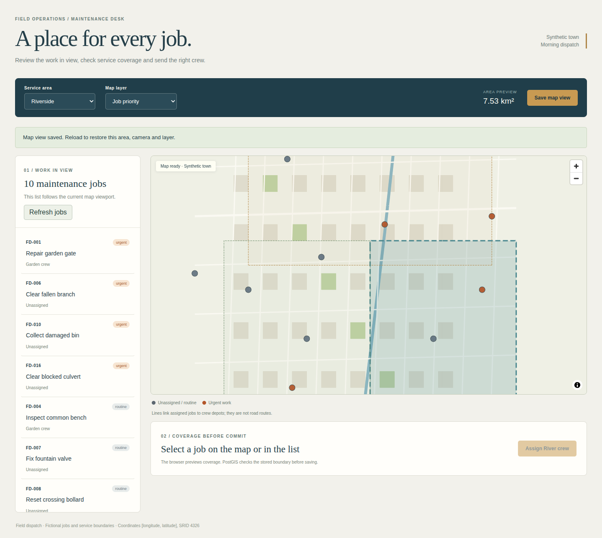
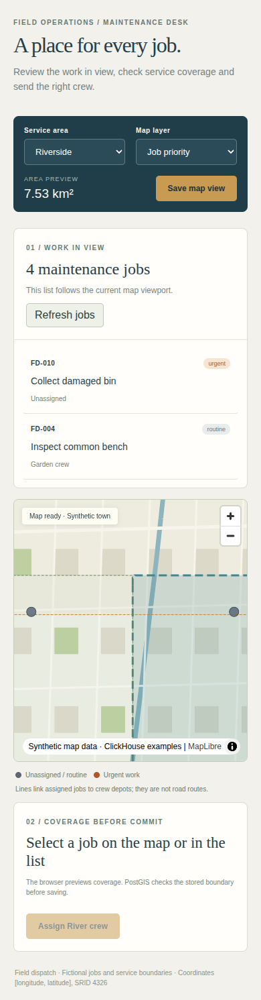

# Field dispatch

A synthetic maintenance desk built with **React, MapLibre GL JS, deck.gl, Turf.js,
PMTiles and PostGIS** on [ClickHouse Managed Postgres](https://clickhouse.com/cloud/postgres).
Pan the town, review jobs within the visible viewport, preview service coverage,
assign the right crew and save the map view for your next session.

**[Start a ClickHouse Cloud trial with $300 in credits](https://clickhouse.com/cloud).**

| Integration | Visible use |
| --- | --- |
| React | Dispatch list, coverage review, layer/area selection and saved-view feedback |
| MapLibre GL JS | Real WebGL map, vector basemap, service boundary layer, viewport events |
| PMTiles | Checked-in v3 archive, range requests and MapLibre protocol; no token |
| deck.gl | Pickable job points and arcs between assigned jobs and crew depots |
| Turf.js | Service area in km², point-in-polygon preview and straight-line depot distance |
| PostGIS | Indexed viewport queries and authoritative stored-boundary assignment checks |

The archive contains wholly synthetic blocks, parks, roads and a river. All jobs
and boundaries are fictional. Arcs represent depot-to-job relationships, not
road routes. Coordinates are `[longitude, latitude]`, SRID 4326; SQL viewports use
degrees. Turf computes the displayed area and distance units.

## Native setup

Use an isolated Linux VM, Node **24.21.0**, npm, `psql`, OpenSSL and `jq`.
Application dependencies and browser binaries belong inside the VM.

```sh
git clone https://github.com/ClickHouse/examples.git
cd examples/applications/field-dispatch
npm ci --ignore-scripts --strict-peer-deps
npm test
npm run check
npm run build
```

Native tests read the real PMTiles archive through the app's HTTP range endpoint
and reject unsupported viewports/revisions. They do not require a database.
The pinned stack uses React 19.3.0, MapLibre 6.12.0, deck.gl 9.4.0,
Turf 7.4.0, PMTiles 4.5.0, pg 8.23.1, Zod 4.6.5 and TypeScript 6.0.3.
The dedicated `@deck.gl/maplibre` adapter supports MapLibre 6 and shares its
WebGL2 context. The lockfile resolves compatible luma/loaders peers without
forcing installation.

## Create Postgres with clickhousectl

Use [clickhousectl](https://clickhouse.com/docs/interfaces/cli) on your provisioning
machine. Cloud management credentials are separate from application credentials.
Install the CLI if needed and authenticate interactively with an Admin API key:

```sh
curl -fsSL https://clickhouse.com/cli | sh
export PATH="$HOME/.local/bin:$PATH"
clickhousectl --version
clickhousectl cloud auth login --interactive
clickhousectl cloud auth status
clickhousectl cloud org list
umask 077
mkdir -p .deployment
```

Create a key using the [Cloud API guide](https://clickhouse.com/docs/cloud/manage/openapi).
In an editor, create `.deployment/resources.env` with an organization ID and an
available AWS region/size:

```dotenv
CH_ORG_ID=YOUR_ORGANIZATION_UUID
DEPLOYMENT_NAME=field-dispatch-example
CLOUD_REGION=YOUR_AVAILABLE_REGION
PG_SIZE=YOUR_AVAILABLE_POSTGRES_SIZE
```

This example uses one Postgres 18 service with no HA. Check current
[pricing](https://clickhouse.com/pricing). Database charges continue until the
service is deleted; stopping Node or the VM does not stop them.

```sh
source .deployment/resources.env
clickhousectl cloud postgres create \
  --org-id "$CH_ORG_ID" --name "$DEPLOYMENT_NAME" \
  --provider aws --region "$CLOUD_REGION" --size "$PG_SIZE" \
  --pg-version 18 --ha-type none --tag project=field-dispatch --json \
  > .deployment/postgres-create.json
PG_SERVICE_ID="$(jq -er '.id' .deployment/postgres-create.json)"
printf 'PG_SERVICE_ID=%s\n' "$PG_SERVICE_ID" >> .deployment/resources.env
```

The receipt contains the initial administrator password, returned once. Keep it
private. If creation is interrupted, inspect the service list before retrying.
A missing receipt does not prove creation failed.

Repeat inspection until `state` is `running`, then download its CA:

```sh
clickhousectl cloud postgres get "$PG_SERVICE_ID" \
  --org-id "$CH_ORG_ID" --json > .deployment/postgres-status.json
jq '{id,state,hostname,username,postgresVersion,size}' .deployment/postgres-status.json
clickhousectl cloud postgres certs get "$PG_SERVICE_ID" \
  --org-id "$CH_ORG_ID" --output .deployment/postgres-ca.pem
```

If provisioning runs outside the VM, transfer only the private database receipt
and CA into the VM's app `.deployment/` directory. Keep Cloud API keys outside
the application. Continue the following steps in that app directory in Linux.

## Roles, schema and seed

Generate separate migration and runtime passwords once and preserve them for
setup retries. Generated hex passwords are safe in the connection URL:

```sh
umask 077
cat > .deployment/passwords.env <<PASSWORDS
PG_MIGRATION_PASSWORD=Aa1_$(openssl rand -hex 30)
PG_APP_PASSWORD=Aa1_$(openssl rand -hex 30)
PASSWORDS
source .deployment/passwords.env
export PG_MIGRATION_PASSWORD PG_APP_PASSWORD
export PGHOST="$(jq -er '.hostname' .deployment/postgres-create.json)"
export PGPORT=5432 PGDATABASE=postgres PGSSLMODE=verify-full
export PGSSLROOTCERT="$PWD/.deployment/postgres-ca.pem"
export PGPASSWORD="$(jq -er '.password' .deployment/postgres-create.json)"
psql -X -v ON_ERROR_STOP=1 -U postgres -f sql/bootstrap.sql
export PGPASSWORD="$PG_MIGRATION_PASSWORD"
psql -X -v ON_ERROR_STOP=1 -U dispatch_migrator -f sql/migrations/001_initial.sql
psql -X -v ON_ERROR_STOP=1 -U dispatch_migrator -f sql/grants.sql
psql -X -v ON_ERROR_STOP=1 -U dispatch_migrator -f sql/seed.sql
unset PGPASSWORD
```

Bootstrap and migration apply once to a fresh database. Repeating the seed adds no
duplicate jobs or teams and does not reset saved assignments. `dispatch_owner`
owns the schema without logging in. The migrator assumes that role. The runtime
can read the fixture and update only assignment/revision and map-view columns;
it cannot change job geometry, insert/delete jobs or run schema DDL.

## Run the dispatch desk

Create a private runtime environment inside the VM:

```sh
umask 077
cat > .env <<ENV
DATABASE_URL=postgresql://dispatch_app:${PG_APP_PASSWORD}@${PGHOST}:5432/postgres
DATABASE_CA_PATH=.deployment/postgres-ca.pem
APP_ORIGIN=http://127.0.0.1:3002
PORT=3002
ENV
npm run build
npm start
```

Use the direct hostname and verified Cloud CA. Keep SSL verification enabled;
do not add SSL query parameters to the URL. Percent-encode manually chosen
passwords that contain URL punctuation. Runtime credentials never enter React.

Open [127.0.0.1:3002](http://127.0.0.1:3002) from macOS while the VM server
runs. [OrbStack automatically forwards Linux machine ports to the Mac](https://docs.orbstack.dev/machines/network#running-servers),
including this loopback listener; no host application dependencies are needed.
Choose a port unused by other host/VM servers. If you change it, change both
`PORT` and `APP_ORIGIN` to match, then open that address. Don't add an SSH tunnel
on the same already-forwarded port: it will report an address conflict.



## Try the workflow

1. Pan the map: the jobs list follows the current viewport through a PostGIS
   `ST_Intersects`/`ST_MakeEnvelope` query. Results clear during refresh/failure;
   **Refresh jobs** retries. At most 100 rows are displayed with the full count.
2. Select **FD-001** in the list or pick its point on the map. **West garden**
   previews its coverage and the straight-line distance from Garden crew's depot.
3. Choose **Assign Garden crew**. PostGIS checks `ST_Covers` against the stored
   polygon, locks the job and checks its revision before committing.
4. Choose **FD-002** under West garden: its outside-area preview disables the
   assignment. Switching to **Riverside** enables River crew's assignment.
5. Switch the map layer to **Job priority**, pan, select another service area,
   and choose **Save map view**. Reload to restore camera, area and layer.
6. Open a second tab to observe stale revision rejection. Refresh jobs before
   retrying an assignment, or reload before saving an outdated map view.

## Verification and limits

With a dedicated seeded disposable database and `.env`:

```sh
npm run test:integration
npx playwright install --with-deps chromium
npm run test:browser
```

The browser suite owns its production Node process. Stop any manually running
server first. The browser suite resets only FD-001/FD-002 to unassigned and the singleton map
view to the initial West garden camera/layer before each dedicated-demo run.
It then changes those assignments and that saved view. SQL tests exercise FD-004
and the view with their current revisions. Browser
checks require actual WebGL2; software Chromium rendering is acceptable inside
the VM, a mocked canvas or placeholder map is not.

This example is a single trusted local dispatch desk without authentication.
Host and mutation-Origin checks bind it to the configured loopback address.
It is not a multi-user authorization design. Add authentication, authorization
and deployment-specific origin controls before exposing it publicly.

Validated inside Ubuntu 24.04 ARM64 against disposable ClickHouse Managed
Postgres **18.6** with PostGIS **3.6.4**, using `dispatch_app` and verified TLS1.3.
The browser passed real WebGL2 rendering, PMTiles206 requests, public deck.gl
point picking, both crew assignments, stale/outside-area rejection, failed
viewport clearing/retry and saved state after replacing the Node process.
Managed SQL passed competing assignment/map writers, runtime grants, and `pg`
wrong-CA/wrong-hostname rejection. Clean locked install, archive tests,
typecheck and build passed; Vite reports a large-bundle advisory for this mapping
stack. Desktop and 390px mobile layouts passed without horizontal overflow.



The tiny archive is checked in, so ordinary setup needs no Python tooling.
To regenerate this synthetic fixture inside Linux:

```sh
python3 -m venv /tmp/dispatch-fixture-tools
/tmp/dispatch-fixture-tools/bin/pip install pmtiles==3.8.1 mapbox-vector-tile==2.2.0
/tmp/dispatch-fixture-tools/bin/python scripts/generate-basemap.py
```

See [third-party notices](THIRD_PARTY_NOTICES.md). There are no paid map keys,
external basemap requests or third-party geographic data.

## Delete your disposable database

Stopping Node or the VM does not delete the Cloud service. Delete only the service
ID you recorded for this example, then verify its absence from inventory:

```sh
source .deployment/resources.env
clickhousectl cloud postgres delete "$PG_SERVICE_ID" --org-id "$CH_ORG_ID" --json
clickhousectl cloud postgres list --org-id "$CH_ORG_ID" --json > .deployment/inventory-after.json
jq --arg id "$PG_SERVICE_ID" '[.. | objects | select(.id? == $id)]' .deployment/inventory-after.json
```
