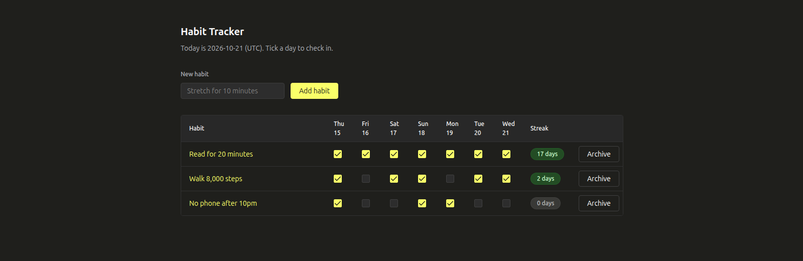
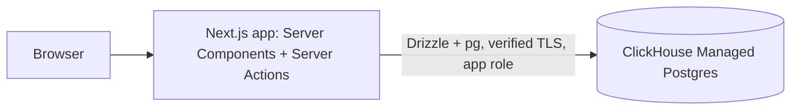

# Habit Tracker: daily check-ins and streaks with Next.js, Drizzle ORM, and ClickHouse Managed Postgres

A habit tracker built with Next.js 16 (App Router, Server Components and Server Actions), Drizzle ORM, node-postgres (`pg`) and Click UI, backed by ClickHouse Managed Postgres and provisioned with `clickhousectl`. You tick a day to check in and see your current streak. Postgres guarantees one check-in per habit per day, even under double clicks, retries and concurrent requests, and it computes streaks with a gaps-and-islands window query.

**[Start a ClickHouse Cloud free trial with $300 in credits](https://clickhouse.com/cloud)** to run this example on ClickHouse Managed Postgres.



Read the walkthrough: [Build a habit tracker with Next.js, Drizzle ORM, and ClickHouse Managed Postgres](https://clickhouse.com/resources/engineering/build-habit-tracker-nextjs-drizzle-postgres)

[ClickHouse Cloud](https://clickhouse.com/cloud) is a managed data platform. It runs [ClickHouse Managed Postgres](https://clickhouse.com/cloud/postgres) for transactional application data and ClickHouse for real-time analytics, managed together with one CLI, [`clickhousectl`](https://clickhouse.com/docs/concepts/features/interfaces/cli).

## Stack

| Layer | Choice |
| --- | --- |
| Framework | Next.js 16.4.2 (App Router, Server Components, Server Actions) |
| Runtime | Node.js 24.x |
| Database | ClickHouse Managed Postgres (PostgreSQL 18) |
| Database access | Drizzle ORM 0.45.4 with node-postgres (`pg`) 8.23.1 |
| Migrations | drizzle-kit 0.31.11 |
| Validation | Zod 4.6.7 |
| UI | Click UI (`@clickhouse/click-ui`) 0.15.0, dark theme |
| Provisioning | `clickhousectl` 0.5.0 |

## How it works



| User action | Server code | SQL |
| --- | --- | --- |
| Open the habit list | `src/app/page.tsx` → `listHabits` | `SELECT` habits, last 7 days of `check_ins`, streak window query |
| Add a habit | `createHabitAction` → `createHabit` | `INSERT INTO habits … RETURNING id` |
| Tick or untick a day | `setCheckInAction` → `setCheckIn` | `INSERT … SELECT … ON CONFLICT DO NOTHING` or `DELETE` |
| Archive a habit | `archiveHabitAction` → `archiveHabit` | `UPDATE habits SET archived_at = now()` |
| Open one habit | `src/app/habits/[id]/page.tsx` → `habitHistory` | `generate_series` of 91 days `LEFT JOIN check_ins` |

Server Actions live in [`src/app/actions.ts`](src/app/actions.ts) and validate input with Zod. The data functions in [`src/lib/habits.ts`](src/lib/habits.ts) take the database as a parameter, so the integration tests call them directly.

**The one check-in per day rule.** `check_ins` has the primary key `(habit_id, day)` ([`src/schema.ts`](src/schema.ts#L54)), so Postgres holds at most one row per habit per day whatever the application does. The checkbox sends the state it should end up in (`done: true` or `done: false`), so a repeated request repeats the same write and can't undo the first one. Checking a day is a single `INSERT … SELECT … ON CONFLICT DO NOTHING` ([`src/lib/habits.ts`](src/lib/habits.ts#L38)). The `SELECT` only returns a row for an active habit owned by the user, and the conflict clause turns a duplicate into a no-op.

```ts
await db
  .insert(checkIns)
  .select(
    db
      .select({
        habitId: habits.id,
        day: sql`${day}::date`.as("day"),
        createdAt: sql`now()`.as("created_at"),
      })
      .from(habits)
      .where(ownedActiveHabit(userId, habitId)),
  )
  .onConflictDoNothing();
```

**Streaks in SQL.** [`streaks()`](src/lib/habits.ts#L85) uses the gaps-and-islands pattern. Within one habit, `day - row_number()` gives the same value for every day in an unbroken run, so grouping by it yields each run's length and last day. A run is the current streak if it ends today or yesterday.

```ts
sql`
with islands as (
  select c.habit_id, c.day,
         c.day - (row_number() over (partition by c.habit_id order by c.day))::int as island
  from ${checkIns} c
  join ${habits} h on h.id = c.habit_id
  where h.user_id = ${userId} and h.archived_at is null
),
runs as (
  select habit_id, max(day) as last_day, count(*)::int as length
  from islands
  group by habit_id, island
)
select habit_id,
       coalesce(max(length) filter (where last_day >= ${today}::date - 1), 0)::int as current,
       max(length)::int as longest
from runs
group by habit_id
`
```

## Connect Next.js and Drizzle to ClickHouse Managed Postgres

[`src/db.ts`](src/db.ts) is the only place a connection pool is created:

```ts
import { readFileSync } from "node:fs";
import { drizzle } from "drizzle-orm/node-postgres";
import { Pool, type PoolConfig } from "pg";
import * as schema from "./schema";

export function poolConfig(
  env: Record<string, string | undefined> = process.env,
): PoolConfig {
  const connectionString = env.DATABASE_URL;
  if (!connectionString)
    throw new Error("Set DATABASE_URL (see .env.example).");
  // pg lets URL parameters such as sslmode replace the ssl object below, so keep
  // TLS settings out of the URL.
  if (new URL(connectionString).search) {
    throw new Error(
      "DATABASE_URL must not have query parameters; set PGSSLROOTCERT for TLS.",
    );
  }
  return {
    connectionString,
    ssl: tlsOptions(connectionString, env.PGSSLROOTCERT),
    max: 5,
    connectionTimeoutMillis: 5_000,
    idleTimeoutMillis: 30_000,
    statement_timeout: 5_000,
    application_name: "habit-tracker",
  };
}

// ClickHouse Managed Postgres: verify the server certificate and hostname
// against the service CA from `clickhousectl cloud postgres certs get`.
// Everything else in this file is plain Postgres.
export function tlsOptions(
  connectionString: string,
  caPath: string | undefined,
) {
  if (caPath)
    return { ca: readFileSync(caPath, "utf8"), rejectUnauthorized: true };
  // Local Postgres from `clickhousectl local postgres` has no TLS. Anything
  // else must have a CA, so a missing variable can't silently disable TLS.
  if (LOCAL_HOSTS.has(new URL(connectionString).hostname)) return false;
  throw new Error("Set PGSSLROOTCERT to the CA file for a remote database.");
}

const LOCAL_HOSTS = new Set(["localhost", "127.0.0.1", "[::1]"]);

export function createDb(
  env: Record<string, string | undefined> = process.env,
) {
  return drizzle({ client: new Pool(poolConfig(env)), schema });
}

export type Db = ReturnType<typeof createDb>;

// One pool per server process. The global survives Next.js hot reloads in dev.
const globalForDb = globalThis as unknown as { habitTrackerDb?: Db };

export function getDb(): Db {
  globalForDb.habitTrackerDb ??= createDb();
  return globalForDb.habitTrackerDb;
}
```

- **TLS:** `ca` plus `rejectUnauthorized: true` checks both the certificate chain and the hostname, which is the same as `sslmode=verify-full`. Keep `sslmode` out of `DATABASE_URL`, because `pg` lets URL parameters override the `ssl` object. Without `PGSSLROOTCERT`, only a local host is allowed, so a missing variable fails fast and never falls back to an unencrypted connection.
- **Pool:** five connections per server process, created lazily on first use and kept on `globalThis` so that `next dev` hot reloads don't open new pools.
- **Timeouts:** a 5-second connect timeout and a 5-second `statement_timeout` sent at connect time. The app role also has `lock_timeout` and `idle_in_transaction_session_timeout` set in [`sql/01_roles.sql`](sql/01_roles.sql).
- **drizzle-kit** opens its own connection, so [`drizzle.config.ts`](drizzle.config.ts) reads the same `DATABASE_URL` and `PGSSLROOTCERT` and reuses `tlsOptions()`. drizzle-kit also loads `.env` if it exists.
- **Click UI** components run as Client Components. They can be rendered from Server Components, except that a function such as `next/link` can't be passed as a prop across that boundary. [`src/components/app-link.tsx`](src/components/app-link.tsx) pairs Click UI's `Link` with `next/link` on the client side.

## Prerequisites

- Node.js 24, `psql` 15 or later, `jq`, `openssl`
- A ClickHouse Cloud account and an API key with permission to create services

```bash
npm ci
```

## Set up ClickHouse Managed Postgres with clickhousectl

```bash
# 1. Install the CLI and sign in (an API key is required to create services)
curl -fsSL https://clickhouse.com/cli | sh
export PATH="$HOME/.local/bin:$PATH"
clickhousectl cloud auth login --api-key "$CLICKHOUSE_CLOUD_API_KEY" --api-secret "$CLICKHOUSE_CLOUD_API_SECRET"
clickhousectl cloud org list

# 2. Choose where the database runs
umask 077 && mkdir -p .deployment
export CH_ORG_ID="<your-org-id>"
export PG_REGION="us-east-1" PG_SIZE="m6gd.large"

# 3. Create ClickHouse Managed Postgres (save the one-time credentials)
clickhousectl cloud postgres create \
  --org-id "$CH_ORG_ID" --name habit-tracker \
  --provider aws --region "$PG_REGION" --size "$PG_SIZE" \
  --pg-version 18 --ha-type none --tag project=habit-tracker \
  --json > .deployment/postgres-create.json
export PG_SERVICE_ID="$(jq -er '.id' .deployment/postgres-create.json)"

# 4. Wait until it is running, then download the CA certificate
clickhousectl cloud postgres get "$PG_SERVICE_ID" --org-id "$CH_ORG_ID" --json | jq '{state, hostname}'
clickhousectl cloud postgres certs get "$PG_SERVICE_ID" --org-id "$CH_ORG_ID" --output .deployment/ca.pem
```

Repeat the `get` command until `state` is `running`. Then point `psql` at the service as the admin user:

```bash
export PGHOST="$(clickhousectl cloud postgres get "$PG_SERVICE_ID" --org-id "$CH_ORG_ID" --json | jq -er '.hostname')"
export PGPORT=5432 PGDATABASE=postgres PGUSER=postgres
export PGPASSWORD="$(jq -er '.password' .deployment/postgres-create.json)"
export PGSSLMODE=verify-full PGSSLROOTCERT="$PWD/.deployment/ca.pem"
psql -c 'select version()'
```

## Create the schema

```bash
export MIGRATOR_PASSWORD="$(openssl rand -hex 24)" APP_PASSWORD="$(openssl rand -hex 24)"
printf 'MIGRATOR_PASSWORD=%s\nAPP_PASSWORD=%s\n' "$MIGRATOR_PASSWORD" "$APP_PASSWORD" > .deployment/passwords.env

psql -X -v ON_ERROR_STOP=1 -f sql/01_roles.sql          # as postgres (admin)
DATABASE_URL="postgres://habit_tracker_migrator:$MIGRATOR_PASSWORD@$PGHOST:$PGPORT/postgres" npm run db:migrate
psql -X -v ON_ERROR_STOP=1 -f sql/02_grants.sql
psql -X -v ON_ERROR_STOP=1 -f sql/03_seed.sql
```

| File | Runs as | What it does |
| --- | --- | --- |
| [`sql/01_roles.sql`](sql/01_roles.sql) | admin | Creates `habit_tracker_migrator` (may create schemas) and `habit_tracker_app` (runtime). Passwords come from the environment via `\getenv`. |
| [`drizzle/`](drizzle) | migrator | `npm run db:migrate` runs `drizzle-kit migrate`. It creates the `habit_tracker` schema and tables, and drizzle-kit records history in its own `drizzle` schema. Regenerate after editing `src/schema.ts` with `npm run db:generate`. |
| [`sql/02_grants.sql`](sql/02_grants.sql) | admin | Gives the app role `SELECT`/`INSERT` on habits, `UPDATE (archived_at)` only, and `SELECT`/`INSERT`/`DELETE` on check-ins. No DDL. |
| [`sql/03_seed.sql`](sql/03_seed.sql) | admin | Adds the demo user and three habits with 90 days of check-ins. Safe to re-run. |

## Run the app

The app connects as the least-privilege app role, never as admin:

```bash
cat > .env <<EOF
DATABASE_URL=postgres://habit_tracker_app:$APP_PASSWORD@$PGHOST:$PGPORT/postgres
PGSSLROOTCERT=$PWD/.deployment/ca.pem
APP_TIME_ZONE=UTC
EOF
npm run dev
```

Open http://localhost:3000. `APP_TIME_ZONE` decides what "today" is. Use any IANA name, such as `Europe/London`.

### Develop against local Postgres (optional)

`clickhousectl` can also run Postgres locally in Docker, without TLS:

```bash
clickhousectl local postgres start habit-tracker
clickhousectl local postgres dotenv habit-tracker --local   # writes POSTGRES_* to .env.local
set -a; . ./.env.local; set +a
export PGHOST="$POSTGRES_HOST" PGPORT="$POSTGRES_PORT" PGUSER="$POSTGRES_USER" PGPASSWORD="$POSTGRES_PASSWORD" PGDATABASE="$POSTGRES_DATABASE"
unset PGSSLMODE PGSSLROOTCERT
```

Then run the same [Create the schema](#create-the-schema) and [Run the app](#run-the-app) commands, leaving the `PGSSLROOTCERT` line out of `.env`. Tear down with `clickhousectl local postgres stop habit-tracker` and `clickhousectl local postgres remove habit-tracker`.

## Try it

1. Open http://localhost:3000. You see three seeded habits with this week's check-ins and streaks: "Read for 20 minutes" has the longest current streak.
2. Add a habit called "Drink 2 litres of water". It appears with an empty week and a `0 days` streak.
3. Tick yesterday and today for it. The streak becomes `2 days`. Reload the page and the ticks are still there.
4. Fire 20 identical "check" writes at once and confirm that Postgres kept one row. The integration test does exactly this. To see it by hand:

   ```bash
   for i in $(seq 20); do psql -X -q -c "insert into habit_tracker.check_ins (habit_id, day) values (1, current_date) on conflict do nothing" & done; wait
   psql -X -At -c "select count(*) from habit_tracker.check_ins where habit_id = 1 and day = current_date"
   # 1
   ```

5. Click a habit name to see its last 91 days as a heatmap, with its current and longest streaks.
6. Archive the new habit. It leaves the list, and its check-ins can no longer change.

## Test

```bash
npm test                       # typecheck + unit tests (dates, validation)
npm run test:integration       # needs DATABASE_URL (reads .env); proves one check-in per day under concurrency
```

The integration suite runs as the app role against real Postgres. It checks that:

- 20 concurrent check-ins leave exactly one row;
- a duplicate plain `INSERT` fails with `23505`;
- unchecking is idempotent;
- streaks are correct across gaps;
- archived and other users' habits can't be changed;
- the app role gets `42501` on DDL;
- on ClickHouse Managed Postgres, `pg_stat_ssl` reports an encrypted connection.

It creates habits named `test-…` and archives them when it finishes.

## Build this with an AI coding agent

Install the ClickHouse agent skills with `clickhousectl skills --agent claude` (or your agent's name), then prompt:

```text
Build a habit tracker with Next.js 16 (App Router, Server Actions), Drizzle ORM and node-postgres
on ClickHouse Managed Postgres. Provision the database with clickhousectl
(postgres create, wait for running, certs get) and connect with verify-full TLS using the service CA.
Use a migrator role for drizzle-kit and a least-privilege app role at runtime.
Enforce one check-in per habit per day with a (habit_id, day) primary key and
INSERT ... ON CONFLICT DO NOTHING, send the desired checked state instead of a toggle,
and compute streaks in SQL with a gaps-and-islands window query.
Add an integration test that fires 20 concurrent check-ins and expects one row.
```

## Limits

- No authentication: every request acts as the seeded demo user (`DEMO_USER_ID` in `src/lib/habits.ts`). Use your auth library's user ID in its place.
- One time zone for everyone (`APP_TIME_ZONE`). Per-user time zones would store a zone per user and compute "today" from it.
- Only the last seven days can be changed. There are no reminders or notifications.
- No deployment configuration. Any Node.js host that can reach the service and read the CA file will work.

## Clean up

```bash
psql -X -v ON_ERROR_STOP=1 -f sql/99_cleanup.sql     # optional if deleting the service
clickhousectl cloud postgres delete "$PG_SERVICE_ID" --org-id "$CH_ORG_ID"
clickhousectl cloud postgres list --org-id "$CH_ORG_ID" --json | jq '.[].name'
rm -rf .deployment .env .env.local
```

## Learn more

- [ClickHouse Managed Postgres docs](https://clickhouse.com/docs/products/managed-postgres/overview)
- [clickhousectl](https://clickhouse.com/docs/concepts/features/interfaces/cli)
- [Next.js: Mutating data with Server Actions](https://nextjs.org/docs/app/getting-started/mutating-data)
- [Drizzle ORM: Get started with PostgreSQL](https://orm.drizzle.team/docs/get-started-postgresql)
- [node-postgres SSL options](https://node-postgres.com/features/ssl)
- Other examples: [Stock Reservation API](../stock-reservation/README.md), [Feature Request Board](../feature-request-board/README.md), [Workshop Booking API](../workshop-booking/README.md)
