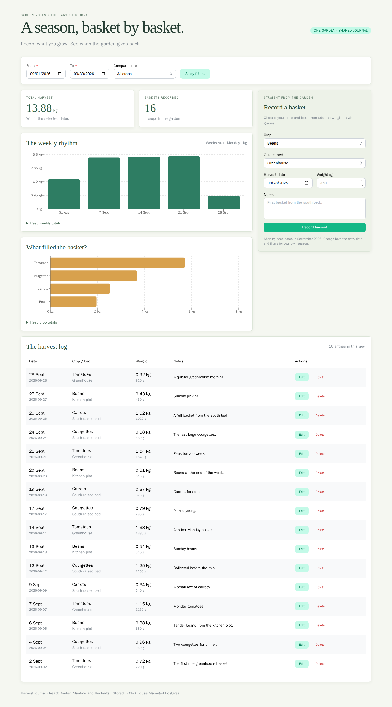
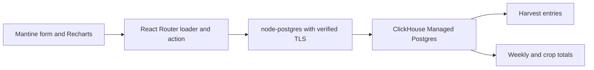

# Harvest dashboard

Keep a garden harvest journal with **React Router framework mode, Mantine Form,
Recharts, Zod and node-postgres**, backed by
[ClickHouse Managed Postgres](https://clickhouse.com/cloud/postgres).

Record a basket, edit its weight, filter the journal and compare weekly yields.
Both charts use SQL aggregates over the same records shown in the journal.
Opening an old edit form cannot silently overwrite a newer edit.



[View the mobile layout](docs/dashboard-mobile.png). These screenshots were
captured against ClickHouse Managed Postgres during the complete browser workflow.

**[Start a ClickHouse Cloud trial with $300 in credits](https://clickhouse.com/cloud).**

## How the pieces connect



[dashboard.tsx](app/routes/dashboard.tsx) contains the route loader, mutation
action and browser interface. Mantine Form validates field values and receives
field errors from the action. A successful fetcher submission revalidates the
loader, which refreshes the table and charts without a second client data cache.

[harvest.server.ts](app/lib/harvest.server.ts) contains parameterized SQL. Each
entry stores a date, whole grams, crop, bed, note and version. An update or delete
must match the version captured when the editor opened. The loader reads
entries, totals and lookups in one repeatable-read snapshot so the displayed
numbers agree even while another tab writes.

Dates remain `YYYY-MM-DD` strings from Postgres to the browser. SQL groups weeks
starting Monday using a timestamp without timezone. The selected start/end dates
are inclusive, and a bucket includes only matching dates in the selected range.
Weeks with no matching entries are omitted. Chart weights display kilograms,
with gram precision available in the journal and three-decimal totals.

This is one synthetic garden for a trusted local operator. The server binds to
loopback and checks the configured application origin for reads and writes;
mutations also require a matching `Origin` header. There is no login or per-user
authorization. Keep it local; adding remote access requires an authentication
and deployment design.

## Run the dashboard

You need a ClickHouse Cloud organization with Managed Postgres access, Git,
Node.js **24.21.0**, npm, `psql`, `curl`, `jq` and OpenSSL. Build and run
dependencies in Linux. macOS maintainers can create an isolated OrbStack VM:

```sh
orbctl create ubuntu:24.04 harvest-dev --isolated --arch arm64 --memory 4G --cpus 2
orbctl run -m harvest-dev -w /home/$USER bash
```

Inside Linux, install the system tools and the pinned Node version:

```sh
sudo apt-get update
sudo apt-get install -y ca-certificates curl git xz-utils postgresql-client jq openssl
curl -fsSL https://nodejs.org/dist/v24.21.0/node-v24.21.0-linux-arm64.tar.xz -o /tmp/node.tar.xz
sudo tar -xJf /tmp/node.tar.xz -C /usr/local --strip-components=1
node --version
git clone https://github.com/ClickHouse/examples.git
cd examples/applications/harvest-dashboard
npm ci --include=dev --ignore-scripts
```

Use `linux-x64` instead of `linux-arm64` on x86 Linux. Node publishes release
checksums alongside its downloads; verify the archive against
[the release checksum file](https://nodejs.org/dist/v24.21.0/SHASUMS256.txt)
when installing. No database is needed for install, typecheck or build.

Pinned versions are React Router 8.4.0, Mantine 9.6.3, Recharts 3.10.1, Zod 4.6.5
and node-postgres 8.23.1. The checked-in lockfile pins transitive dependencies.
Mantine 9 uses the Grid `gap` prop. The explicit server entry avoids React
Router's automatic default-entry dependency installation.

### Create the database with clickhousectl

Install [clickhousectl](https://clickhouse.com/docs/interfaces/cli) on your
provisioning machine. In the isolated maintainer workflow, Cloud management
credentials remain on the macOS host.

```sh
curl -fsSL https://clickhouse.com/cli | sh
export PATH="$HOME/.local/bin:$PATH"
clickhousectl --version
clickhousectl cloud auth login --interactive
clickhousectl cloud auth status
clickhousectl cloud org list
umask 077
mkdir -p .deployment
```

Create an Admin API key using the [Cloud API guide](https://clickhouse.com/docs/cloud/manage/openapi)
and enter it interactively. Creation needs API-key authentication.

Create `.deployment/resources.env` in an editor with your organization ID and
an available AWS region/size:

```dotenv
CH_ORG_ID=YOUR_ORGANIZATION_UUID
DEPLOYMENT_NAME=harvest-dashboard-example
CLOUD_REGION=YOUR_AVAILABLE_REGION
PG_SIZE=YOUR_AVAILABLE_POSTGRES_SIZE
```

This example uses one non-HA Postgres 18 service. Check current
[pricing](https://clickhouse.com/pricing) before creating it. Database charges
continue until the service is deleted; stopping Node or the VM does not stop them.

```sh
source .deployment/resources.env
clickhousectl cloud postgres create \
  --org-id "$CH_ORG_ID" --name "$DEPLOYMENT_NAME" \
  --provider aws --region "$CLOUD_REGION" --size "$PG_SIZE" \
  --pg-version 18 --ha-type none --tag project=harvest-dashboard --json \
  > .deployment/postgres-create.json
PG_SERVICE_ID="$(jq -er '.id' .deployment/postgres-create.json)"
printf 'PG_SERVICE_ID=%s\n' "$PG_SERVICE_ID" >> .deployment/resources.env
```

The receipt contains the initial administrator password, returned once. Keep
it private. If creation is interrupted, inspect the service list before retrying;
a missing receipt does not prove that creation failed.

Repeat inspection until `state` is `running`, then download the CA:

```sh
clickhousectl cloud postgres get "$PG_SERVICE_ID" \
  --org-id "$CH_ORG_ID" --json > .deployment/postgres-status.json
jq '{id, state, hostname, username, postgresVersion, size}' .deployment/postgres-status.json
clickhousectl cloud postgres certs get "$PG_SERVICE_ID" \
  --org-id "$CH_ORG_ID" --output .deployment/postgres-ca.pem
```

Use `--output` for a usable PEM. Add the direct endpoint and actual administrator
username from the service response to `.deployment/resources.env`:

```dotenv
PGHOST=YOUR_DIRECT_POSTGRES_HOSTNAME
PGPORT=5432
PGDATABASE=postgres
PGADMIN=YOUR_SERVICE_ADMIN_USERNAME
```

For an isolated VM, transfer only the source, CA and database credentials needed
for each step into its own filesystem. Cloud API keys stay on the provisioning
machine. Use the direct endpoint, not a transaction-pooler endpoint.

### Apply roles, schema and seed data

Generate passwords once, saving them for setup retries:

```sh
umask 077
cat > .deployment/passwords.env <<PASSWORDS
PG_MIGRATION_PASSWORD=Aa1_$(openssl rand -hex 30)
PG_APP_PASSWORD=Aa1_$(openssl rand -hex 30)
PASSWORDS
source .deployment/resources.env
source .deployment/passwords.env
export PGHOST PGPORT PGDATABASE PG_MIGRATION_PASSWORD PG_APP_PASSWORD
export PGSSLMODE=verify-full
export PGSSLROOTCERT="$PWD/.deployment/postgres-ca.pem"
export PGPASSWORD="$(jq -er '.password' .deployment/postgres-create.json)"
psql -X -v ON_ERROR_STOP=1 -U "$PGADMIN" -f sql/bootstrap.sql
export PGPASSWORD="$PG_MIGRATION_PASSWORD"
psql -X -v ON_ERROR_STOP=1 -U harvest_migrator -f sql/migrations/001_initial.sql
psql -X -v ON_ERROR_STOP=1 -U harvest_migrator -f sql/grants.sql
psql -X -v ON_ERROR_STOP=1 -U harvest_migrator -f sql/seed.sql
unset PGPASSWORD
```

Bootstrap creates a non-login owner, a migration login that can assume that
owner, and the `harvest_app` runtime login. Runtime can read crops/beds and
create, edit or delete harvest entries. It cannot create tables, change schema
or modify seed lookups. Passwords are read from environment variables by
`psql`, rather than appearing in SQL files or command arguments.

Bootstrap and the initial migration apply once; each is transactional. Keep a
record of successfully applied files and resume at the next file after a
failure. Grants can be reapplied. Seed inserts stable IDs without resetting
edited rows, so rerunning it doesn't duplicate the original 16 harvests.

### Configure and start the app

In the Linux application directory, create the runtime environment:

```sh
umask 077
cat > .env <<RUNTIME
DATABASE_URL=postgresql://harvest_app:${PG_APP_PASSWORD}@${PGHOST}:${PGPORT}/${PGDATABASE}
DATABASE_CA_PATH=.deployment/postgres-ca.pem
APP_ORIGIN=http://127.0.0.1:3000
HOST=127.0.0.1
PORT=3000
RUNTIME
unset PG_MIGRATION_PASSWORD PG_APP_PASSWORD
npm run build
npm start
```

If your own password has special characters, percent-encode it in the URL.
Use a plain connection URL with no query parameters.
[database.server.ts](app/lib/database.server.ts) supplies the CA, expected
server hostname and `rejectUnauthorized: true` explicitly; TLS URL parameters
can override node-postgres's TLS object. The pool allows five connections and
bounds connection/query time.

Open [127.0.0.1:3000](http://127.0.0.1:3000). If the server runs in a headless
OrbStack VM, keep a second terminal on macOS running this SSH tunnel (replace
`harvest-dev` with your VM name):

```bash
ssh -N -L 3000:127.0.0.1:3000 harvest-dev@orb
```

Then open that same address in your macOS browser. This forwards the VM's
loopback port without installing application dependencies on macOS, and keeps
`APP_ORIGIN=http://127.0.0.1:3000`. Stop the tunnel with Ctrl-C when finished.
Automated browser checks use Chromium inside the VM.
`APP_ORIGIN`, `HOST` and `PORT` must refer to the same local address.
For development, stop the production process and run `npm run dev`.

## Try the journal

The initial view shows September 2026, four crops, three beds and 16 entries.
Record a basket of 450 grams on September 28. Its row appears in the journal,
and the weekly and crop totals update after the action completes.

Edit its weight in one tab while keeping the same editor open in a second tab.
Saving the second form returns a conflict message, preserving the first edit.
Reload and reopen the entry to edit its current version.

Filter by crop or date, and delete your added entry. Dates belong to the garden
journal, not a timezone. Update the initial entry date and filters for your own
season. Filters are shareable URL parameters. The log shows the latest 200
matching entries; a visible note explains when the charts include more entries
than the displayed table. Expand the readable tables below either chart for its
exact aggregated values.

## Verify behavior

Maintainer verification used Ubuntu 24.04 ARM64, Node 24.21.0 and ClickHouse
Managed Postgres 18.6, provisioned with `clickhousectl`. Clean install, typecheck,
build, database checks and Chromium workflows passed, including a genuine server
process replacement and persisted edit. The disposable managed service was
deleted after verification.

Run the secret-free checks inside Linux:

```sh
npm test
npm run typecheck
npm run build
```

With `.env` pointing to a dedicated seeded test service, run:

```sh
npm run test:integration
npx playwright install --with-deps chromium
npm run test:browser
```

Stop any manually started server before `test:browser`; the browser suite owns
its local server process and replaces that process during its persistence check.

The integration suite creates its own temporary entries, checks competing
edits, stale deletion, Monday/week-boundary buckets and chart-total equality,
then removes those entries. It also exercises runtime permission denials and
wrong-CA/wrong-hostname failures through node-postgres. The browser suite records,
edits and deletes an entry, submits invalid/cross-origin mutations, verifies a
genuine server replacement, checks an empty date range and saves desktop/mobile
screenshots. Run these against this disposable example database, not production.

## Scope and cleanup

This is a small journal, with synthetic records and no file uploads,
authentication, deployment automation or analytics service. It demonstrates
ordinary Postgres application storage and SQL aggregation. Vite reports a large
dashboard bundle because charts and form components load together; this is not
a frontend performance benchmark.

If the database cannot be reached, check service readiness, direct host/port,
runtime password and CA file. Keep certificate/hostname verification enabled.
A stale-form message means the row changed or disappeared; reload before editing.

Stop Node. For a dedicated service created for this example, check the saved
ID/name and delete it with clickhousectl:

```sh
source .deployment/resources.env
clickhousectl cloud postgres get "$PG_SERVICE_ID" --org-id "$CH_ORG_ID" --json
clickhousectl cloud postgres delete "$PG_SERVICE_ID" --org-id "$CH_ORG_ID"
clickhousectl cloud postgres list --org-id "$CH_ORG_ID" --json
```

Confirm the recorded ID is absent. Deletion removes its data and stops ongoing
database compute charges. If retaining the service but removing only this
example, run the destructive `sql/cleanup.sql` explicitly as the service
administrator using the verified TLS environment above. Never apply the entire
SQL directory: it includes cleanup.

Keep source and useful receipts, remove unnecessary private credentials, and
stop the dedicated VM with `orbctl stop harvest-dev`.
