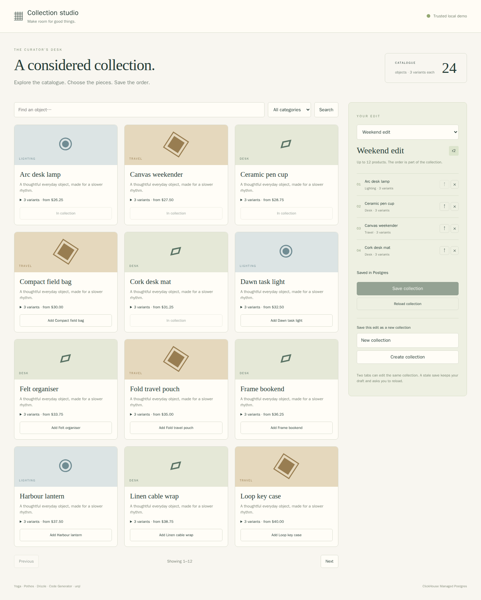

# Collection studio: typed GraphQL and Postgres

Explore a small design catalogue, inspect variants, and curate an ordered
collection. Save a new collection from your draft, move products up, remove items,
and save again. A stale tab receives a conflict and keeps its draft until reload.



This is a trusted local demo with synthetic products, no accounts or payments.
It binds to loopback and checks Host and write Origin.

## How the pieces fit

Pothos constructs Product, Variant and Collection types from typed Drizzle rows
and explicit resolvers. GraphQL Yoga serves the schema through Bun’s Fetch API.
Drizzle queries Postgres and commits collection revisions and item replacements
atomically. A request-scoped DataLoader batches variant lookups. GraphQL Code
Generator emits real typed operation documents from the printed Pothos schema;
urql runs those queries and mutations in React.

The catalogue has 24 seeded products and three variants each. Pagination accepts
`first` 1–20 and `offset` 0–10,000; the UI shows twelve products per page.
Collections contain at most twelve distinct products with unique ordered
positions 0–11. The switcher lists the first twenty collections by title. This
small local workbench does not expose a public arbitrary-query API.

Stable Drizzle uses explicit resolvers, avoiding the Pothos Drizzle plugin’s
release-candidate relational API requirement.

## Get the source and tools

Run application dependencies inside Linux. On macOS, an isolated
[OrbStack machine](https://docs.orbstack.dev/machines/isolated) keeps dependencies
off the host:

```sh
orbctl create ubuntu:noble catalog-dev --isolated --arch arm64 --memory 4G --cpus 2
orbctl run -m catalog-dev -w /home/$USER bash
```

Inside Linux:

```sh
sudo apt-get update
sudo apt-get install -y ca-certificates curl git unzip jq openssl postgresql-client docker.io
sudo systemctl start docker
sudo usermod -aG docker "$USER"
# Reopen your Linux shell so the Docker group applies.
curl -fsSL https://bun.sh/install -o /tmp/bun-install.sh
bash /tmp/bun-install.sh bun-v1.4.2
export PATH="$HOME/.bun/bin:$HOME/.local/bin:$PATH"
curl -fsSL https://clickhouse.com/cli | sh
git clone https://github.com/ClickHouse/examples.git
cd examples/applications/product-graphql
bun install --frozen-lockfile --ignore-scripts
```

The checked-in lockfile pins the library versions. Bun must report `1.4.2`.
No third-party application service is required. Cloud lifecycle commands may
instead run with an existing host `clickhousectl`; copy only the database CA and
step-specific credentials into the VM, keeping Cloud API keys on the host.

## Choose a database

### Local Postgres with clickhousectl

```sh
umask 077
mkdir -p .deployment
clickhousectl local postgres start --name catalog --version 18 --json \
  > .deployment/local-create.json
export PGHOST=127.0.0.1
export PGPORT="$(jq -er '.port' .deployment/local-create.json)"
export PGDATABASE="$(jq -er '.database' .deployment/local-create.json)"
export PGADMIN="$(jq -er '.user' .deployment/local-create.json)"
export PGPASSWORD="$(jq -er '.password' .deployment/local-create.json)"
export PGSSLMODE=disable
```

Use the actual returned port. This receipt contains a password and belongs in
the ignored private directory.

### ClickHouse Managed Postgres with clickhousectl

Create an Admin API key following the
[Cloud API guide](https://clickhouse.com/docs/cloud/manage/openapi), then enter
it interactively:

```sh
clickhousectl cloud auth login --interactive
clickhousectl cloud auth status
clickhousectl cloud org list
umask 077
mkdir -p .deployment
```

Create `.deployment/resources.env` in an editor with your organization, an
available AWS region and Postgres size:

```dotenv
CH_ORG_ID=YOUR_ORGANIZATION_UUID
CLOUD_REGION=YOUR_AVAILABLE_REGION
PG_SIZE=YOUR_AVAILABLE_SIZE
```

One non-HA Postgres 18 service is enough for this example. Review
[pricing](https://clickhouse.com/pricing) before creating it. Compute, storage,
backups and network usage can incur charges; stopping the application or VM
does not stop the managed service's billing.

```sh
source .deployment/resources.env
clickhousectl cloud postgres create --org-id "$CH_ORG_ID" \
  --name product-graphql-example --provider aws --region "$CLOUD_REGION" \
  --size "$PG_SIZE" --pg-version 18 --ha-type none \
  --tag project=product-graphql --json > .deployment/postgres-create.json
PG_SERVICE_ID="$(jq -er '.id' .deployment/postgres-create.json)"
```

Save the service ID in `.deployment/resources.env`. Preserve the create receipt:
its initial password is returned once. If creation is interrupted, inspect
`clickhousectl cloud postgres list --org-id "$CH_ORG_ID" --json` before retrying.

Repeat inspection until `state` is `running`:

```sh
clickhousectl cloud postgres get "$PG_SERVICE_ID" --org-id "$CH_ORG_ID" --json \
  > .deployment/postgres-status.json
jq '{id,state,hostname,username,postgresVersion,size}' .deployment/postgres-status.json
clickhousectl cloud postgres certs get "$PG_SERVICE_ID" --org-id "$CH_ORG_ID" \
  --output .deployment/postgres-ca.pem
```

Use the service's actual direct hostname, port, database and administrator.
For a direct service connection, use port 5432 and database `postgres`; check the service response for the actual connection details:

```sh
export PGHOST="$(jq -er '.hostname' .deployment/postgres-status.json)"
export PGPORT=5432 PGDATABASE=postgres
export PGADMIN="$(jq -er '.username' .deployment/postgres-status.json)"
export PGPASSWORD="$(jq -er '.password' .deployment/postgres-create.json)"
export PGSSLMODE=verify-full
export PGSSLROOTCERT="$PWD/.deployment/postgres-ca.pem"
```

## Apply roles, schema and seed

Run once on your dedicated fresh database. Passwords are read by psql from
environment variables and do not become command arguments.

```sh
cat > .deployment/passwords.env <<PASSWORDS
PG_MIGRATION_PASSWORD=Aa1_$(openssl rand -hex 24)
PG_APP_PASSWORD=Aa1_$(openssl rand -hex 24)
PASSWORDS
source .deployment/passwords.env
export PG_MIGRATION_PASSWORD PG_APP_PASSWORD
psql -X -v ON_ERROR_STOP=1 -U "$PGADMIN" -f sql/001_roles.sql
export PGPASSWORD="$PG_MIGRATION_PASSWORD"
psql -X -v ON_ERROR_STOP=1 -U catalog_migration -f sql/002_schema.sql
psql -X -v ON_ERROR_STOP=1 -U catalog_migration -f sql/003_seed.sql
unset PGPASSWORD
```

The migration login is a member of a non-login schema owner. The runtime
`catalog_app` login has narrower grants. The seed creates 24 products, 72 variants and a three-product collection; repeating only the seed preserves existing edits.

## Configure and open the workbench

```sh
cat > .env <<RUNTIME
DATABASE_URL=postgres://catalog_app:${PG_APP_PASSWORD}@${PGHOST}:${PGPORT}/${PGDATABASE}
PG_CA_CERT_PATH=.deployment/postgres-ca.pem
APP_ORIGIN=http://127.0.0.1:3001
PORT=3001
RUNTIME
unset PG_MIGRATION_PASSWORD PG_APP_PASSWORD
```

For local Postgres only, add `DATABASE_LOCAL=true` to `.env`. The bypass requires
a loopback database host. Managed connections use the service CA, hostname
verification and `rejectUnauthorized: true`. Do not add SSL URL query parameters.
On Bun 1.4.2’s specific rotation-bundle signature failure, the connector retries
only supplied CA anchors, preserving hostname verification. Update the CA and
restart the process when the service certificates rotate.

Run inside the VM:

```sh
bun install --frozen-lockfile --ignore-scripts
bun run codegen
bun run typecheck
bun run test
bun run build
bun run start
```

The runtime is Bun 1.4.2. `schema.graphql` and `src/client/gql` are generated
artifacts intentionally committed for inspection. Regenerate after changing the
schema or operation file; do not hand-edit them. All installs/builds stay in the
VM. From a separate host terminal, forward its loopback port:

```sh
ssh -N -L 3001:127.0.0.1:3001 catalog-dev@orb
```

Open http://127.0.0.1:3001. Search for Canvas, expand its variants and add the
weekender to Quiet workspace. Create a Weekend collection from that draft,
move the weekender up, and save. Reload preserves the selected collection ID in
the URL. Open the same URL in another tab before saving to see stale-edit recovery.

## The useful database behavior

Replacement first conditionally updates the header at the loaded revision.
Within the same Drizzle transaction it checks every product, removes old items
and inserts new positions. A stale revision returns `CONFLICT`; a rejected
product rolls the header version and item changes back. The runtime login can
read catalogue data and edit collections, but cannot modify products, variants,
collection titles or schema.

A new DataLoader belongs to each request. A batched `WHERE product_id IN (...)`
query fetches variants and regroups them in requested key order. The seeded
comparison measured two SQL SELECTs for 1, 12 and 20 products with variants. This
is a query-count observation, not a latency or scale guarantee. A collection
query also reads its header and joins ordered items to products.

## Verify on a dedicated database

The suite creates/deletes its own temporary collection rows. Use a disposable
database and save the migration URL privately in `.deployment/test.env` as
`DATABASE_TEST_ADMIN_URL`.

```sh
set -a
source .deployment/test.env
set +a
bun run test:integration
```

Checks cover actual SELECT counts, eight concurrent same-version replacements,
ordered contents, rollback after a missing product, invalid page/items, runtime
grants and a real Yoga request.

With the app running, install the browser inside the VM:

```sh
bunx playwright install --with-deps chromium
bun run test:browser
```

The browser filters products, inspects variants, creates a collection, reorders,
saves/reloads and recovers a stale tab. It writes
`test-results/product-graphql.png` and leaves a synthetic Weekend collection.
For restart verification, save a collection, stop the process with Ctrl-C,
restart using `bun run start`, and open the same URL. Compare revision and order.

## Cleanup

Delete only the fixture you created. Managed deletion is permanent; stopping
the application or VM does not stop service billing.

```sh
clickhousectl local postgres stop catalog
source .deployment/resources.env
clickhousectl cloud postgres get "$PG_SERVICE_ID" --org-id "$CH_ORG_ID" --json
clickhousectl cloud postgres delete "$PG_SERVICE_ID" --org-id "$CH_ORG_ID"
clickhousectl cloud postgres list --org-id "$CH_ORG_ID" --json
# Verify the owned PG_SERVICE_ID is absent.
```

Keep `.env` and `.deployment` private and remove credentials when no longer
needed. The demo has no per-user access control, checkout, inventory management
or public deployment configuration.
