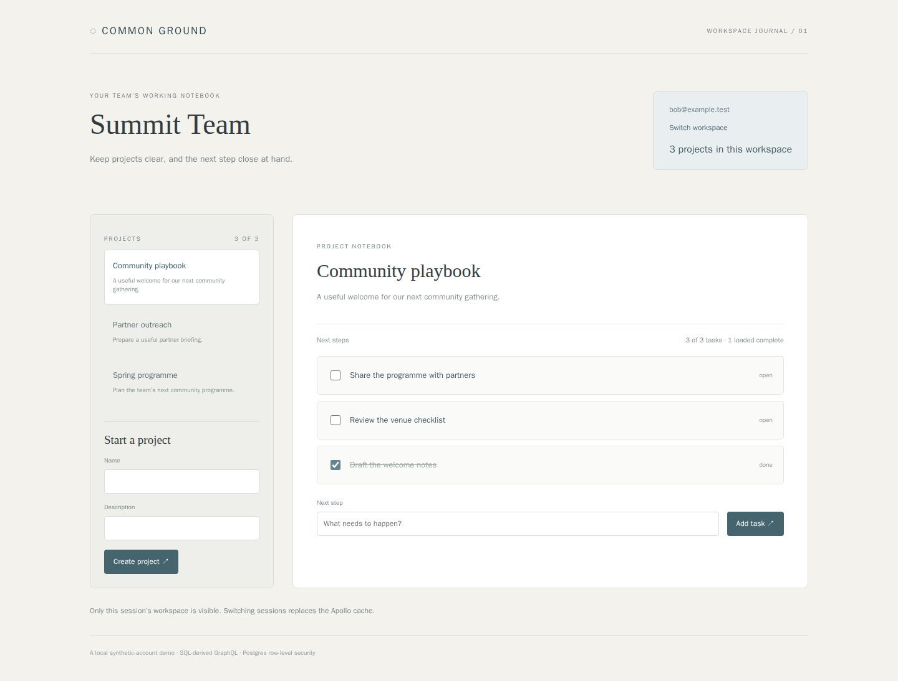

# Common Ground: a database-first project notebook

A two-workspace project and task app using **PostGraphile 5**, **Grafast** and **Apollo Client**, backed by ClickHouse Managed Postgres. SQL foreign keys generate the nested GraphQL API; verified synthetic-account sessions select the database role and workspace. Postgres row-level security enforces the boundary.

The browser creates projects, adds tasks, updates checkboxes and pages through real cursor connections. Signing into another workspace replaces its Apollo client and normalized cache. The server executes the generated schema with Grafast; there are no handwritten project/task resolvers.



## Tools and source

Use an isolated Linux VM for dependencies. On macOS, [OrbStack isolated machines](https://docs.orbstack.dev/machines/isolated) provide a convenient option:

```sh
orbctl create ubuntu:noble ground-dev --isolated --arch arm64 --memory 4G --cpus 2
orbctl run -m ground-dev bash
```

Inside Linux, install Docker, curl, git, jq, OpenSSL and a Postgres client. Install [Node.js 24 LTS](https://nodejs.org/en/download) and confirm `node --version` reports `v24.21.0`; its native TypeScript support runs the server without a transpiler. Install clickhousectl:

```sh
curl -fsSL https://clickhouse.com/cli | sh
export PATH="$HOME/.local/bin:$PATH"
git clone https://github.com/ClickHouse/examples.git
cd examples/applications/project-graphql
npm ci
```

The lockfile pins PostGraphile 5.1.5, Grafast 1.1.4 and Apollo Client 4.3.1. Cloud lifecycle commands can use an existing host clickhousectl; copy only database credentials and the CA into the VM, keeping Cloud API credentials on the host.

## Choose a fresh database

### Local Postgres

Docker must be running and accessible to your Linux user. The local receipt contains a password:

```sh
umask 077
mkdir -p .deployment
clickhousectl local postgres start --name common-ground --version 18 --json \
  > .deployment/local-create.json
export PGHOST=127.0.0.1
export PGPORT="$(jq -er '.port' .deployment/local-create.json)"
export PGDATABASE="$(jq -er '.database' .deployment/local-create.json)"
export PGADMIN="$(jq -er '.user' .deployment/local-create.json)"
export PGPASSWORD="$(jq -er '.password' .deployment/local-create.json)"
export PGSSLMODE=disable
export DATABASE_LOCAL=true
```

### ClickHouse Managed Postgres

Create an Admin API key using the [Cloud API guide](https://clickhouse.com/docs/cloud/manage/openapi), then authenticate interactively:

```sh
clickhousectl cloud auth login --interactive
clickhousectl cloud auth status
clickhousectl cloud org list
umask 077
mkdir -p .deployment
```

Save your organization UUID, available region and size as `CH_ORG_ID`, `CLOUD_REGION` and `PG_SIZE` in `.deployment/resources.env`. Review [pricing](https://clickhouse.com/pricing); the managed service continues to incur charges when the app or VM stops.

```sh
source .deployment/resources.env
clickhousectl cloud postgres create --org-id "$CH_ORG_ID" \
  --name project-graphql-example --provider aws --region "$CLOUD_REGION" \
  --size "$PG_SIZE" --pg-version 18 --ha-type none \
  --tag project=project-graphql --json > .deployment/postgres-create.json
PG_SERVICE_ID="$(jq -er '.id' .deployment/postgres-create.json)"
```

Save the ID in the private resources file. Preserve the create receipt: its initial password is returned once. If creation is interrupted, inspect the organization service list before retrying. Repeat inspection until the service is running:

```sh
clickhousectl cloud postgres get "$PG_SERVICE_ID" --org-id "$CH_ORG_ID" --json \
  > .deployment/postgres-status.json
jq '{id,state,hostname,username,postgresVersion,size}' .deployment/postgres-status.json
clickhousectl cloud postgres certs get "$PG_SERVICE_ID" --org-id "$CH_ORG_ID" \
  --output .deployment/postgres-ca.pem
export PGHOST="$(jq -er '.hostname' .deployment/postgres-status.json)"
export PGPORT=5432 PGDATABASE=postgres
export PGADMIN="$(jq -er '.username' .deployment/postgres-status.json)"
export PGPASSWORD="$(jq -er '.password' .deployment/postgres-create.json)"
export PGSSLMODE=verify-full
export PGSSLROOTCERT="$PWD/.deployment/postgres-ca.pem"
export PG_CA_CERT_PATH="$PGSSLROOTCERT"
unset DATABASE_LOCAL
```

These are direct-service port/database defaults; the actual service response is authoritative. The runtime connector requires the supplied CA and hostname verification. It rejects TLS settings embedded in URL query parameters.

## Roles, schema and synthetic accounts

Apply once to your dedicated fresh database. Passwords stay in ignored files and environment variables rather than command arguments:

```sh
cat > .deployment/passwords.env <<PASSWORDS
PG_MIGRATION_PASSWORD=Aa1_$(openssl rand -hex 24)
PG_APP_PASSWORD=Aa1_$(openssl rand -hex 24)
PASSWORDS
source .deployment/passwords.env
export PG_MIGRATION_PASSWORD PG_APP_PASSWORD
psql -X -v ON_ERROR_STOP=1 -U "$PGADMIN" -f sql/roles.sql
export PGPASSWORD="$PG_MIGRATION_PASSWORD"
psql -X -v ON_ERROR_STOP=1 -U tracker_migration -f sql/schema.sql
psql -X -v ON_ERROR_STOP=1 -U tracker_migration -f sql/seed.sql
export MIGRATION_DATABASE_URL="postgresql://tracker_migration:$PG_MIGRATION_PASSWORD@$PGHOST:$PGPORT/$PGDATABASE"
node scripts/seed-users.ts
unset MIGRATION_DATABASE_URL PGPASSWORD
cat > .env <<RUNTIME
DATABASE_URL=postgresql://tracker_api:$PG_APP_PASSWORD@$PGHOST:$PGPORT/$PGDATABASE
APP_ORIGIN=http://127.0.0.1:3002
RUNTIME
if [ "${DATABASE_LOCAL:-}" = true ]; then
  echo 'DATABASE_LOCAL=true' >> .env
else
  printf 'PG_CA_CERT_PATH=%s\n' "$PG_CA_CERT_PATH" >> .env
fi
chmod 600 .env
unset PG_MIGRATION_PASSWORD PG_APP_PASSWORD
```

`tracker_migration` owns the schemas. `tracker_api` is a restricted `NOINHERIT` login; it can validate hashed passwords and opaque sessions in `tracker_private`, but does not inherit project access. GraphQL transactions assume `tracker_member` and set `app.workspace_id` from the verified session. Settings are transaction-local. The exposed `tracker` tables all have RLS; tasks also have a composite project/workspace foreign key.

Synthetic accounts: **alice@example.test / river-demo** uses Riverside Studio; **bob@example.test / summit-demo** uses Summit Team. These published demo credentials are for a trusted local demonstration, not a production identity service. Passwords use salted scrypt verifiers; the database stores only hashes of random session tokens. Cookies are HttpOnly and SameSite=Strict; the app binds loopback and enforces its configured Host and Origin. There is no GraphiQL route or public schema introspection endpoint.

## Run and explore

```sh
npm run schema
npm run typecheck
npm run build
npm start
```

Open `http://127.0.0.1:3002` inside Linux or directly from the host using
[OrbStack's automatic port forwarding](https://docs.orbstack.dev/machines/network#running-servers).
Use a unique `APP_ORIGIN` port when running several VMs; the app binds that
loopback port and validates the same Host/Origin. A same-port SSH tunnel can
conflict with OrbStack's forwarding.

Sign in, create a project, add a task and complete it. Switch workspaces and confirm the other team's rows appear. Switch back and inspect the saved task. Projects load 20 at a time and nested tasks load 50; the UI shows loaded/total counts and offers **Load more**. Timestamp indexes expose generated `CREATED_AT_DESC` ordering; a new row appears on the refreshed first page. The selected project has its own detail query, independent of list pagination.

`schema.graphql` is generated by the installed PostGraphile version using member-role introspection. `src/client/operations.ts` contains typed Apollo query/mutation documents. `src/server/preset.ts` connects SQL-derived schema construction to verified per-request Grafast context; `src/server/index.ts` uses Grafast's documented schema execution API. The request layer limits body size, operation length, expanded depth/field count and connection page sizes, including fragments.

## Validate

With the app running against a dedicated test database:

```sh
npm test
npm run test:integration
npx playwright install --with-deps chromium
npm run test:browser
```

Integration tests add pagination fixtures and saved rows. They exercise real HTTP sessions, nested workspace isolation, forged scope headers, cross-workspace writes, actual member-role privilege denials, pooled context reset, connection bounds and pages beyond 20 projects/50 tasks. Browser tests use actual Apollo queries/mutations and cache replacement. A separate browser control delays an old session response and simulates network failure to verify UI ordering/error handling; it does not claim server-side rejection of those simulated failures.

Verified against local Postgres 18 and ClickHouse Managed Postgres 18.6: typecheck/build, three unit checks, seven API/role checks and two browser tests passed. A separate real app process restart preserved the verified session, project, three tasks and completed checkbox. Managed TLS was verified with the supplied CA; unrelated CA and a reachable server under an incorrect URL hostname both failed certificate validation.

To inspect persistence, create a task, complete it, stop the app and restart `npm start` with the same `.env`. The session, project and task should remain saved; no data lives solely in the Apollo cache.

## Cleanup

Stop the application first. For the local fixture:

```sh
clickhousectl local postgres stop --name common-ground
```

For your owned disposable managed service:

```sh
source .deployment/resources.env
clickhousectl cloud postgres delete "$PG_SERVICE_ID" --org-id "$CH_ORG_ID" --json
clickhousectl cloud postgres list --org-id "$CH_ORG_ID" --json > .deployment/postgres-after.json
jq --arg id "$PG_SERVICE_ID" '[.[] | select(.id == $id)]' .deployment/postgres-after.json
```

Confirm the list contains no service with that ID. Delete only the resource you created for this example; retain private receipts until cleanup is verified.
