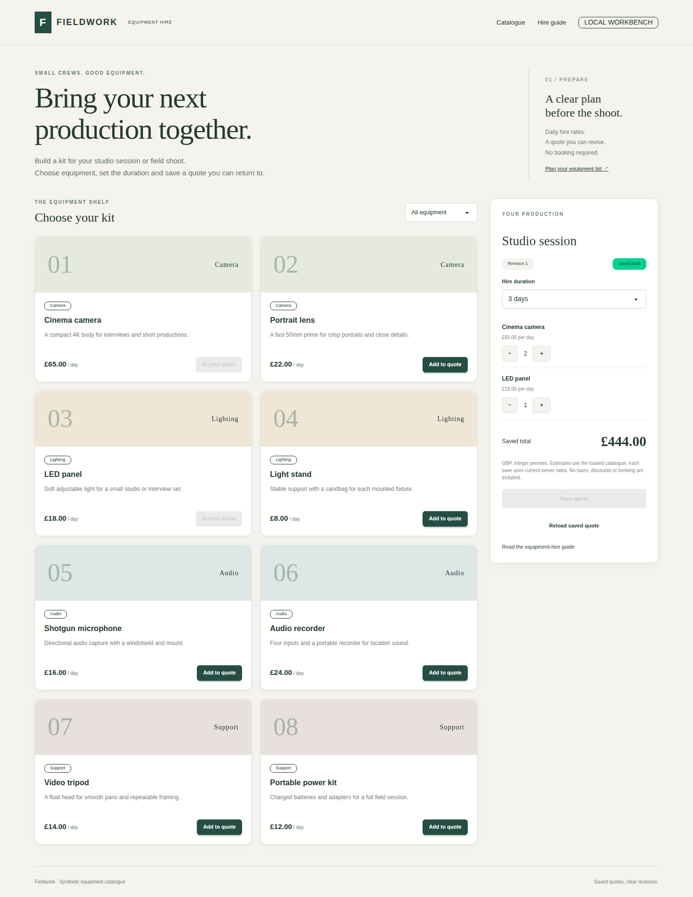

# Equipment quote catalogue

Build and save a small equipment-hire quote with **Astro**, **Preact**, **daisyUI**, **oRPC**, **ArkType**, **Kysely**, and [ClickHouse Managed Postgres](https://clickhouse.com/cloud/postgres).

Astro renders the editorial catalogue introduction and hire guide. A hydrated Preact island lets you filter eight synthetic products, choose quantities and hire days, save a quote, and recover it after a server restart. daisyUI supplies cards, controls, badges, alerts and the reload confirmation dialog. The typed oRPC contract validates actual inputs and outputs with ArkType. Kysely reads current prices and saves the header and line snapshots in one Postgres transaction.



The application is a trusted local workbench, with no sign-in, payment or reservation flow. Two seeded quote headers are shared local drafts. A quote does not reserve equipment.

## Run the example

Use Linux, Node 24.21.0, npm 11, psql 15+, curl, jq and OpenSSL. On macOS, work in an [isolated OrbStack machine](https://docs.orbstack.dev/machines/isolated) with source copied into its own home directory. Install application dependencies in Linux, not on the host.

```sh
git clone https://github.com/ClickHouse/examples.git
cd examples/applications/quote-catalogue
npm ci
npm run check
npm run build
```

Pinned versions are Astro 7.3.5, Node adapter 11.1.6, Astro Preact integration 6.0.5, Preact 10.29.8, daisyUI 5.7.47, Tailwind 4.3.3, oRPC 1.15.4, ArkType 2.2.7, Kysely 0.29.6, pg 8.23.1 and TypeScript 6.0.3. Astro's Preact integration supports Preact 10; Astro's checker supports TypeScript 5 or 6. Use the lockfile rather than upgrading those packages independently.

### 1. Authenticate clickhousectl

Install [clickhousectl](https://clickhouse.com/docs/concepts/features/interfaces/cli) on the machine that will manage your Cloud resources:

```sh
curl -fsSL https://clickhouse.com/cli | sh
export PATH="$HOME/.local/bin:$PATH"
clickhousectl --version
clickhousectl cloud auth login --interactive
clickhousectl cloud auth status
clickhousectl cloud org list
umask 077
mkdir -p .deployment
```

Creation requires an Admin API key. Enter credentials at the prompt. Keep Cloud API credentials outside the app and browser; in an isolated maintainer workflow, management stays on the host and only database credentials and the CA enter Linux.

Create `.deployment/resources.env` with your organization and supported AWS region/size:

```dotenv
CH_ORG_ID=YOUR_ORGANIZATION_UUID
DEPLOYMENT_NAME=quote-catalogue-example
CLOUD_REGION=YOUR_AVAILABLE_AWS_REGION
PG_SIZE=YOUR_AVAILABLE_POSTGRES_SIZE
```

The tested PostgreSQL 18.6 fixture used us-east-1, c6gd.large, Postgres 18 and no HA. Review [pricing](https://clickhouse.com/pricing) before creation. The service incurs charges until deleted; stopping the API or VM does not stop database billing.

### 2. Create the service and retrieve its CA

```sh
source .deployment/resources.env
clickhousectl cloud postgres create --org-id "$CH_ORG_ID" \
  --name "$DEPLOYMENT_NAME" --provider aws --region "$CLOUD_REGION" \
  --size "$PG_SIZE" --pg-version 18 --ha-type none \
  --tag project=quote-catalogue --json > .deployment/postgres-create.json
PG_SERVICE_ID="$(jq -er '.id' .deployment/postgres-create.json)"
printf 'PG_SERVICE_ID=%s\n' "$PG_SERVICE_ID" >> .deployment/resources.env
```

Preserve the private receipt, including its one-time administrator password. Repeat **get**, not creation, until state is running:

```sh
clickhousectl cloud postgres get "$PG_SERVICE_ID" --org-id "$CH_ORG_ID" \
  --json > .deployment/postgres-status.json
jq '{id, state, hostname, username, postgresVersion, size}' .deployment/postgres-status.json
clickhousectl cloud postgres certs get "$PG_SERVICE_ID" --org-id "$CH_ORG_ID" \
  --output .deployment/postgres-ca.pem
```

If creation was interrupted, reconcile the receipt with `clickhousectl cloud postgres list --org-id "$CH_ORG_ID" --json` before creating anything else.

### 3. Bootstrap roles, migrate and seed

Continue inside Linux with the private database receipt and CA available. Generate passwords once and preserve this file on retries:

```sh
cat > .deployment/passwords.env <<PASSWORDS
PG_OWNER_PASSWORD=Aa1_$(openssl rand -hex 24)
PG_APP_PASSWORD=Aa1_$(openssl rand -hex 24)
PASSWORDS
source .deployment/passwords.env
export PGHOST="$(jq -er '.hostname' .deployment/postgres-status.json)"
export PGUSER="$(jq -er '.username' .deployment/postgres-status.json)"
export PGPORT=5432 PGDATABASE=postgres PGSSLMODE=verify-full
export PGSSLROOTCERT="$PWD/.deployment/postgres-ca.pem"
export PGPASSWORD="$(jq -er '.password' .deployment/postgres-create.json)"
export PG_OWNER_PASSWORD PG_APP_PASSWORD
psql -X -v ON_ERROR_STOP=1 -f sql/bootstrap.sql
unset PGPASSWORD

cat > .deployment/owner.env <<OWNER
HOST=127.0.0.1
PORT=4321
APP_ORIGIN=http://127.0.0.1:4321
DB_HOST=$PGHOST
DB_PORT=5432
DB_DATABASE=postgres
DB_USER=quote_catalogue_owner
DB_PASSWORD=$PG_OWNER_PASSWORD
PG_CA_CERT_PATH=$PGSSLROOTCERT
OWNER
node --env-file=.deployment/owner.env --import tsx scripts/migrate.ts
node --env-file=.deployment/owner.env --import tsx scripts/seed.ts
PGUSER=quote_catalogue_owner PGPASSWORD="$PG_OWNER_PASSWORD" \
  psql -X -v ON_ERROR_STOP=1 -f sql/grants.sql
```

Bootstrap creates a schema owner and separate restricted runtime login. It runs once and rolls back if the roles already exist. Kysely's Migrator records applied migrations in the example schema. The seed inserts missing products and two empty quotes without resetting saved drafts. Resume at the failing step instead of recreating resources.

### 4. Start with runtime credentials

```sh
sed -e 's/^DB_USER=.*/DB_USER=quote_catalogue_app/' \
  -e "s/^DB_PASSWORD=.*/DB_PASSWORD=$PG_APP_PASSWORD/" \
  .deployment/owner.env > .deployment/app.env
chmod 600 .deployment/*.env
unset PG_OWNER_PASSWORD PG_APP_PASSWORD
set -a
source .deployment/app.env
set +a
npm start
```

Open `http://127.0.0.1:4321` in Linux, or tunnel the VM's loopback port using the same configured host and origin. The start script permits only a loopback listener. Requests must use the configured Host; RPC requests require the same Origin and the client's custom header. No database credentials enter the browser. The database pool uses separate fields, the Cloud CA and verified TLS, with at most five connections per process.

## Try a quote

1. Add **Cinema camera**, then increase its quantity to 2.
2. Add **LED panel** and select 3 hire days. The estimate is **£444.00**.
3. Click **Save quote**. The server calculates the saved total from current Postgres prices. Reload to recover quantities, duration, revision and rate snapshots.
4. Filter the catalogue to **Audio**. Filtering leaves the quote intact.
5. Open the same quote in another tab, then save a change in the first. Saving edits from the older tab shows a conflict and keeps those edits visible. Reloading asks before discarding them.
6. Open **Hire guide** to read Astro-rendered planning notes. `/?quote=2` opens the second seeded quote.

All prices are integer GBP pennies. Estimates use the catalogue loaded with the page. Each save reprices the full quote from current server prices and captures unit-price snapshots. Later price changes do not rewrite an already-saved quote. There are no taxes, discounts, delivery charges or payment promises.

[contract.ts](src/lib/contract.ts) declares the input/output schemas. Quantities must be whole numbers 1–20, duration 1–14 days, and a save must include 1–10 unique known products. Client prices/totals are undeclared keys and rejected. [quotes.ts](src/server/quotes.ts) locks the quote header, checks its revision, reads prices, replaces lines and increments the revision atomically. Invalid products and duplicate lines fail before writes. A failed insert restores both old lines and the old header. Shared read locks keep returned lines and revision coherent.

Runtime can read the catalogue/quotes, replace quote lines, and update only duration/revision/timestamp on headers. It cannot change prices, delete headers or create schema objects. The separate owner runs migrations and fixture tests.

## Verify and clean up

```sh
npm run check
npm run build
npx playwright install --with-deps chromium
```

For live tests, stop the running app and use a dedicated example database. Copy app.env to a private test.env and add `TEST_OWNER_PASSWORD` with this schema owner's password. The tests create their own quotes/products and delete them afterward; the integration test briefly adds a fixture-specific constraint in this dedicated schema.

```sh
node --env-file=.deployment/test.env --import tsx tests/integration.ts
node --env-file=.deployment/test.env --import tsx tests/browser.ts
node --env-file=.deployment/app.env --import tsx scripts/probe.ts
node --env-file=.deployment/app.env --import tsx scripts/probe.ts --wrong-host
```

The integration test uses the actual typed oRPC HTTP client, invalid inputs, price tampering, competing revisions, a genuine server restart, snapshot/repricing behavior, atomic failure and restricted grants. Chromium exercises the real Preact island and daisyUI controls. The last probe is a deliberate failure, connecting to the same service IP with a wrong TLS name. A wrong-CA control points `PG_CA_CERT_PATH` to an unrelated test CA. Keep negative results separate from passing controls.

Stop the app with Ctrl-C. Verify the private receipt's ID, then delete only a service created exclusively for this example:

```sh
source .deployment/resources.env
clickhousectl cloud postgres get "$PG_SERVICE_ID" --org-id "$CH_ORG_ID" --json
clickhousectl cloud postgres delete "$PG_SERVICE_ID" --org-id "$CH_ORG_ID"
clickhousectl cloud postgres list --org-id "$CH_ORG_ID" --json
```

Deletion removes the service and its data. Confirm its ID is absent, then remove unneeded credential files. Keep source and any evidence you need. The small eight-item catalogue is a teaching example, not a scale benchmark.
