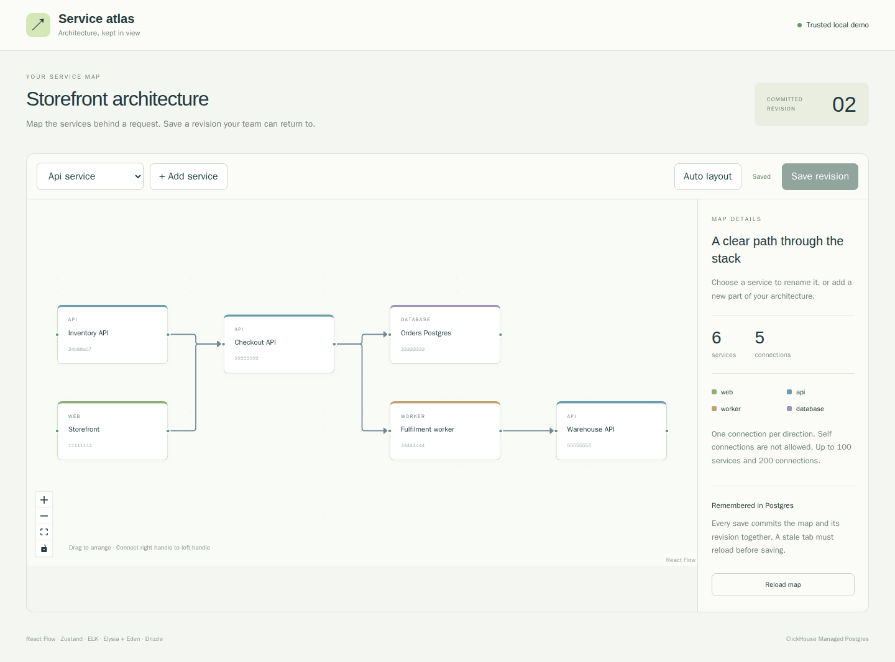

# Service atlas

Build and save a small service architecture map with React Flow, Zustand, ELK,
Elysia, Eden Treaty, and Drizzle's Bun SQL driver, backed by
[ClickHouse Managed Postgres](https://clickhouse.com/cloud/postgres).

Add services, connect them, drag them into place, or let ELK arrange the graph.
Every save commits the current document and a revision snapshot together. If two
tabs edit the same revision, one saves and the other gets a visible conflict.



This is a trusted local demo using synthetic architecture metadata. It listens
on loopback and checks the configured Host and write Origin. There are no user
accounts, network discovery, automatic service execution, or live collaboration.

## How the pieces fit

| Library           | Actual use                                                             |
| ----------------- | ---------------------------------------------------------------------- |
| React Flow        | Draggable service cards, connection handles, edges, zoom and selection |
| Zustand           | Draft nodes/edges, unsaved state, revision and conflict state          |
| ELK.js            | Layered automatic layout using the actual graph's nodes and edges      |
| Elysia            | Typed routes, structural validation and explicit error responses       |
| Eden Treaty       | Typed reads and saves using a type-only backend import                 |
| Drizzle + Bun SQL | Conditional updates, JSONB documents and atomic snapshot inserts       |

`service_topology.graphs` stores a header, revision and current JSONB document.
`service_topology.revisions` has a primary key on `(graph_id, revision)` and
stores each committed snapshot. The runtime login can read both tables, update
the current document/revision, and insert snapshots. It cannot update or delete
snapshots or change the schema.

Maps allow up to 100 services and 200 directed connections. Service names are
1–60 characters, IDs are UUIDs, coordinates are bounded finite numbers, and
connections must reference existing services. Self connections and repeated
connections in the same direction are rejected. Reverse connections are allowed.

[repository.ts](src/server/repository.ts) updates with both ID and base revision
in its predicate. It inserts the snapshot in the same transaction. A zero-row
update returns `409`. If insertion fails, the current document also rolls back.
Reads return the document and revision from one row.

## Get the source and tools

Run application dependencies inside Linux. On macOS, an isolated
[OrbStack machine](https://docs.orbstack.dev/machines/isolated) keeps dependencies
off the host:

```sh
orbctl create ubuntu:noble topology-dev --isolated --arch arm64 --memory 4G --cpus 2
orbctl run -m topology-dev -w /home/$USER bash
```

Inside Linux:

```sh
sudo apt-get update
sudo apt-get install -y ca-certificates curl git unzip jq openssl postgresql-client docker.io
sudo systemctl start docker
sudo usermod -aG docker "$USER"
# Reopen your Linux shell so the Docker group applies.
curl -fsSL https://bun.sh/install -o /tmp/bun-install.sh
bash /tmp/bun-install.sh bun-v1.4.2
export PATH="$HOME/.bun/bin:$HOME/.local/bin:$PATH"
curl -fsSL https://clickhouse.com/cli | sh
git clone https://github.com/ClickHouse/examples.git
cd examples/applications/service-topology
bun install --frozen-lockfile --ignore-scripts
```

The checked-in lockfile pins the library versions. Bun must report `1.4.2`.
No third-party application service is required. Cloud lifecycle commands may
instead run with an existing host `clickhousectl`; copy only the database CA and
step-specific credentials into the VM, keeping Cloud API keys on the host.

## Choose a database

### Local Postgres with clickhousectl

```sh
umask 077
mkdir -p .deployment
clickhousectl local postgres start --name topology --version 18 --json \
  > .deployment/local-create.json
export PGHOST=127.0.0.1
export PGPORT="$(jq -er '.port' .deployment/local-create.json)"
export PGDATABASE="$(jq -er '.database' .deployment/local-create.json)"
export PGADMIN="$(jq -er '.user' .deployment/local-create.json)"
export PGPASSWORD="$(jq -er '.password' .deployment/local-create.json)"
export PGSSLMODE=disable
```

Use the actual returned port. This receipt contains a password and belongs in
the ignored private directory.

### ClickHouse Managed Postgres with clickhousectl

Create an Admin API key following the
[Cloud API guide](https://clickhouse.com/docs/cloud/manage/openapi), then enter
it interactively:

```sh
clickhousectl cloud auth login --interactive
clickhousectl cloud auth status
clickhousectl cloud org list
umask 077
mkdir -p .deployment
```

Create `.deployment/resources.env` in an editor with your organization, an
available AWS region and Postgres size:

```dotenv
CH_ORG_ID=YOUR_ORGANIZATION_UUID
CLOUD_REGION=YOUR_AVAILABLE_REGION
PG_SIZE=YOUR_AVAILABLE_SIZE
```

One non-HA Postgres 18 service is enough for this example. Review
[pricing](https://clickhouse.com/pricing) before creating it. Compute, storage,
backups and network usage can incur charges; stopping the application or VM
does not stop the managed service's billing.

```sh
source .deployment/resources.env
clickhousectl cloud postgres create --org-id "$CH_ORG_ID" \
  --name service-topology-example --provider aws --region "$CLOUD_REGION" \
  --size "$PG_SIZE" --pg-version 18 --ha-type none \
  --tag project=service-topology --json > .deployment/postgres-create.json
PG_SERVICE_ID="$(jq -er '.id' .deployment/postgres-create.json)"
```

Save the service ID in `.deployment/resources.env`. Preserve the create receipt:
its initial password is returned once. If creation is interrupted, inspect
`clickhousectl cloud postgres list --org-id "$CH_ORG_ID" --json` before retrying.

Repeat inspection until `state` is `running`:

```sh
clickhousectl cloud postgres get "$PG_SERVICE_ID" --org-id "$CH_ORG_ID" --json \
  > .deployment/postgres-status.json
jq '{id,state,hostname,username,postgresVersion,size}' .deployment/postgres-status.json
clickhousectl cloud postgres certs get "$PG_SERVICE_ID" --org-id "$CH_ORG_ID" \
  --output .deployment/postgres-ca.pem
```

Use the service's actual direct hostname, port, database and administrator.
For a direct service connection, use port 5432 and database `postgres`; check the service response for the actual connection details:

```sh
export PGHOST="$(jq -er '.hostname' .deployment/postgres-status.json)"
export PGPORT=5432 PGDATABASE=postgres
export PGADMIN="$(jq -er '.username' .deployment/postgres-status.json)"
export PGPASSWORD="$(jq -er '.password' .deployment/postgres-create.json)"
export PGSSLMODE=verify-full
export PGSSLROOTCERT="$PWD/.deployment/postgres-ca.pem"
```

## Apply roles, schema and seed

Run once on your dedicated fresh database. Passwords are read by psql from
environment variables and do not become command arguments.

```sh
cat > .deployment/passwords.env <<PASSWORDS
PG_MIGRATION_PASSWORD=Aa1_$(openssl rand -hex 24)
PG_APP_PASSWORD=Aa1_$(openssl rand -hex 24)
PASSWORDS
source .deployment/passwords.env
export PG_MIGRATION_PASSWORD PG_APP_PASSWORD
psql -X -v ON_ERROR_STOP=1 -U "$PGADMIN" -f sql/001_roles.sql
export PGPASSWORD="$PG_MIGRATION_PASSWORD"
psql -X -v ON_ERROR_STOP=1 -U topology_migration -f sql/002_schema.sql
psql -X -v ON_ERROR_STOP=1 -U topology_migration -f sql/003_seed.sql
unset PGPASSWORD
```

The migration login is a member of a non-login schema owner. The runtime
`topology_app` login has narrower grants. The seed creates five services and
four connections; repeating only the seed preserves existing edits.

## Configure and open the editor

Create the runtime environment while the generated runtime password is available.
These hex passwords are URL-safe; percent-encode passwords you supply yourself.

```sh
cat > .env <<RUNTIME
DATABASE_URL=postgres://topology_app:${PG_APP_PASSWORD}@${PGHOST}:${PGPORT}/${PGDATABASE}
PG_CA_CERT_PATH=.deployment/postgres-ca.pem
PORT=3000
APP_ORIGIN=http://127.0.0.1:3000
RUNTIME
unset PG_MIGRATION_PASSWORD PG_APP_PASSWORD
```

For VM-local Postgres only, add `DATABASE_LOCAL=true` to `.env`. This bypass is
restricted to loopback database hosts. Managed connections use the downloaded
CA, certificate/hostname verification, and a bounded five-connection pool.
Bun 1.4.2 can reject CA rotation bundles with duplicate subjects. On that specific
signature failure, the connector retries only certificates from the downloaded
bundle, with certificate and hostname verification still enabled. Restart the app
after updating the CA bundle.
Use a plain URL without query parameters; the server configures TLS explicitly.

```sh
bun run typecheck
bun run test
bun run build
bun start
```

Open `http://127.0.0.1:3000`. If the app runs in an isolated OrbStack VM, forward
its loopback port from a host terminal:

```sh
ssh -N -L 3000:127.0.0.1:3000 topology-dev@orb
```

1. Add an API service and click it to rename it.
2. Drag its card, then drag a right handle to another service's left handle.
3. Click **Auto layout**, then **Save revision**. The committed revision increases.
4. Refresh; your names, positions and connections remain.
5. Load two tabs, change both, save the first, then save the second. The second
   reports a conflict. Its reload button explicitly discards the stale draft.
6. Remove a service and save. Its incident connections disappear too.

For a Vite development client, set `APP_ORIGIN=http://127.0.0.1:5173` in the
server environment, run `bun run dev` and `bun run dev:web` in separate terminals,
and open that origin. Both servers bind to loopback; Vite proxies `/api`.

## Check the meaningful behavior

Secret-free checks:

```sh
bun run typecheck
bun run test
bun run build
```

Database tests create and remove their own temporary graph rows. Run only against
a dedicated example database. Put the migration login URL in a private
`.deployment/test.env` as `DATABASE_TEST_ADMIN_URL`, then:

```sh
set -a
source .deployment/test.env
set +a
bun run test:integration
unset DATABASE_TEST_ADMIN_URL
```

The suite tests 16 concurrent edits, JSONB roundtrip, invalid graphs, rollback
when snapshot insertion fails, and denied runtime privileges. The intended
snapshot-failure check logs `Graph save failed.` while the test passes.

With the built server running, install Chromium inside Linux and run the actual
browser flow:

```sh
bunx playwright install --with-deps chromium
bun run test:browser
```

It exercises dragging, connection creation, layout, save/reload, a second tab's
conflict and persisted removal. It advances the seeded graph's revision and
writes a screenshot to `test-results/topology.png`. For a process-restart check,
save a map, stop Bun with Ctrl-C, run `bun start` again, and compare the graph.

The [custom JSONB type](src/server/schema.ts) is deliberate: Bun 1.4.2 encodes
objects for JSONB itself. Passing Drizzle's default stringified JSON parameter
would encode a string twice. The application keeps the graph object intact
through the Bun SQL integration and verifies the database's JSONB object type.

## Scope and cleanup

Revision snapshots are retained; the UI edits the current map and does not offer
history browsing or restoration. A lost save response can leave your tab with a
stale revision; reload to resolve it. Graph metadata is synthetic and the server
has no per-user authorization. Keep it local.

Stop the app before cleanup. Preserve any source you want to keep.

```sh
# Local database: stop preserves its data.
clickhousectl local postgres stop topology

# Managed service: inspect the owned fixture, then permanently delete it.
source .deployment/resources.env
clickhousectl cloud postgres get "$PG_SERVICE_ID" --org-id "$CH_ORG_ID" --json
clickhousectl cloud postgres delete "$PG_SERVICE_ID" --org-id "$CH_ORG_ID"
clickhousectl cloud postgres list --org-id "$CH_ORG_ID" --json
# Verify the owned PG_SERVICE_ID is absent from the returned list.

# If you used OrbStack:
orbctl stop topology-dev
```

Only delete the service you created for this example. Remove its private
credential files when they are no longer needed.
