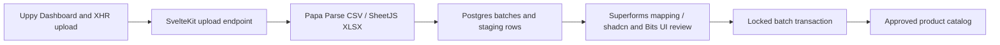

# Supplier spreadsheet intake

Review a supplier CSV or XLSX file before it reaches your product catalog.
**SvelteKit, Superforms, shadcn-svelte, Bits UI, Uppy, Papa Parse and SheetJS CE**
provide the upload and review flow; [ClickHouse Managed Postgres](https://clickhouse.com/cloud/postgres)
stores the batches, source values, validation results and approved products.

**[Start a ClickHouse Cloud trial with $300 in credits](https://clickhouse.com/cloud).**

## Receive, review, promote



The file's SHA-256 fingerprint identifies a batch. Uploading the same bytes again
opens that batch instead of creating more staging rows. Review maps the supplier's
headers to SKU, product, USD price and stock. The original values remain intact;
validated values and row errors are stored separately.

Promotion locks the batch, checks its reviewed revision, and inserts all rows in
one transaction. A supplier/SKU conflict rolls back the complete import. A second
promotion request sees the completed batch and does not add duplicates. A stale
review cannot overwrite another tab's mapping. A read-only repeatable-read
snapshot keeps batch metadata and reviewed rows coherent during another review.

| Integration | Actual role in the app |
| --- | --- |
| SvelteKit | Upload endpoint, server loaders and named review/promotion actions; Node adapter |
| Superforms | Mapping and supplier metadata, shared Zod 4 validation, enhanced form feedback |
| shadcn-svelte | Generated Nova Button, Badge, Input and Tabs source components |
| Bits UI | Accessible tabs underneath shadcn; direct accordion for row corrections |
| Uppy | Real file selection, restrictions, progress and multipart XHR upload |
| Papa Parse | CSV quoting and text-preserving parsing |
| SheetJS CE | Genuine XLSX worksheet input and included workbook fixture generation |

[parsers.ts](src/lib/server/parsers.ts) normalizes both formats.
[intake.ts](src/lib/server/intake.ts) owns parameterized SQL and transactions.
[BatchReview.svelte](src/lib/components/BatchReview.svelte) shows the reviewed
mapping, unchanged source values, row errors and promotion result.

## Prerequisites and native setup

Build and run inside Linux or an isolated OrbStack VM. Do not install the app's
dependencies on macOS. You need Node **24.21.0**, npm, Git, `psql`, `jq`, OpenSSL
and a ClickHouse Cloud organization with Managed Postgres access.

On an Ubuntu ARM64 VM, if the tools are not already present:

```sh
sudo apt-get update
sudo apt-get install -y ca-certificates curl git xz-utils postgresql-client jq openssl
curl -fsSL https://nodejs.org/dist/v24.21.0/node-v24.21.0-linux-arm64.tar.xz -o /tmp/node.tar.xz
sudo tar -xJf /tmp/node.tar.xz -C /usr/local --strip-components=1
node --version
git clone https://github.com/ClickHouse/examples.git
cd examples/applications/supplier-intake
npm ci --ignore-scripts
npm test
npm run check
npm run build
```

Use `linux-x64` on x86 Linux. Verify Node's archive against its
[release checksum file](https://nodejs.org/dist/v24.21.0/SHASUMS256.txt).
Native checks do not require a database.

Pinned versions include SvelteKit **2.70.3**, Svelte **5.57.1**, adapter-node
**5.5.7**, Superforms **3.0.0**, Bits UI **2.19.5**, Uppy core **6.2.0**,
Papa Parse **5.7.0**, SheetJS CE **0.20.3** and TypeScript **6.0.3**.
The maintained Kit 2 release preserves the configuration and alias conventions
used by the shadcn-svelte 1.7.0 generator. We don't force incompatible peers to
use Kit 3. The lockfile pins transitive packages too.

SheetJS uses the [official distribution](https://docs.sheetjs.com/docs/getting-started/installation/nodejs/),
not the older npm registry `xlsx` release. Its tarball URL and integrity are in the
lockfile. The generated shadcn components are checked in; installation does not
rerun its CLI. See [third-party notices](THIRD_PARTY_NOTICES.md) and the copied
[shadcn license](SHADCN-LICENSE.md).

## Create Postgres with clickhousectl

Use [clickhousectl](https://clickhouse.com/docs/interfaces/cli) on your provisioning
machine. Cloud management credentials are separate from application credentials.
Install the CLI if needed and authenticate interactively with an Admin API key:

```sh
curl -fsSL https://clickhouse.com/cli | sh
export PATH="$HOME/.local/bin:$PATH"
clickhousectl --version
clickhousectl cloud auth login --interactive
clickhousectl cloud auth status
clickhousectl cloud org list
umask 077
mkdir -p .deployment
```

Create a key using the [Cloud API guide](https://clickhouse.com/docs/cloud/manage/openapi).
In an editor, create `.deployment/resources.env` with an organization ID and an
available AWS region/size:

```dotenv
CH_ORG_ID=YOUR_ORGANIZATION_UUID
DEPLOYMENT_NAME=supplier-intake-example
CLOUD_REGION=YOUR_AVAILABLE_REGION
PG_SIZE=YOUR_AVAILABLE_POSTGRES_SIZE
```

This example uses one Postgres 18 service with no HA. Check current
[pricing](https://clickhouse.com/pricing). Database charges continue until the
service is deleted; stopping Node or the VM does not stop them.

```sh
source .deployment/resources.env
clickhousectl cloud postgres create \
  --org-id "$CH_ORG_ID" --name "$DEPLOYMENT_NAME" \
  --provider aws --region "$CLOUD_REGION" --size "$PG_SIZE" \
  --pg-version 18 --ha-type none --tag project=supplier-intake --json \
  > .deployment/postgres-create.json
PG_SERVICE_ID="$(jq -er '.id' .deployment/postgres-create.json)"
printf 'PG_SERVICE_ID=%s\n' "$PG_SERVICE_ID" >> .deployment/resources.env
```

The receipt contains the initial administrator password, returned once. Keep it
private. If creation is interrupted, inspect the service list before retrying.
A missing receipt does not prove creation failed.

Repeat inspection until `state` is `running`, then download its CA:

```sh
clickhousectl cloud postgres get "$PG_SERVICE_ID" \
  --org-id "$CH_ORG_ID" --json > .deployment/postgres-status.json
jq '{id,state,hostname,username,postgresVersion,size}' .deployment/postgres-status.json
clickhousectl cloud postgres certs get "$PG_SERVICE_ID" \
  --org-id "$CH_ORG_ID" --output .deployment/postgres-ca.pem
```

If provisioning runs outside the VM, transfer only the private database receipt
and CA into the VM's app `.deployment/` directory. Keep Cloud API keys outside
the application. Continue the following steps in that app directory in Linux.

## Roles, schema and seed

Generate separate migration and runtime passwords once and preserve them for
setup retries. Generated hex passwords are safe in the connection URL:

```sh
umask 077
cat > .deployment/passwords.env <<PASSWORDS
PG_MIGRATION_PASSWORD=Aa1_$(openssl rand -hex 30)
PG_APP_PASSWORD=Aa1_$(openssl rand -hex 30)
PASSWORDS
source .deployment/passwords.env
export PG_MIGRATION_PASSWORD PG_APP_PASSWORD
export PGHOST="$(jq -er '.hostname' .deployment/postgres-create.json)"
export PGPORT=5432 PGDATABASE=postgres PGSSLMODE=verify-full
export PGSSLROOTCERT="$PWD/.deployment/postgres-ca.pem"
export PGPASSWORD="$(jq -er '.password' .deployment/postgres-create.json)"
psql -X -v ON_ERROR_STOP=1 -U postgres -f sql/bootstrap.sql
export PGPASSWORD="$PG_MIGRATION_PASSWORD"
psql -X -v ON_ERROR_STOP=1 -U intake_migrator -f sql/migrations/001_initial.sql
psql -X -v ON_ERROR_STOP=1 -U intake_migrator -f sql/grants.sql
psql -X -v ON_ERROR_STOP=1 -U intake_migrator -f sql/seed.sql
unset PGPASSWORD
```

Bootstrap and migration apply once to a fresh database. The seed is repeatable:
it adds two products from Willow Cooperative without replacing existing data.
`intake_owner` is a non-login schema owner; `intake_migrator` assumes that role.
`intake_app` can read/write staging and insert catalog products. It cannot change
schema or update/delete existing catalog products.

## Run the receiving desk

Create the private runtime environment:

```sh
umask 077
cat > .env <<ENV
DATABASE_URL=postgresql://intake_app:${PG_APP_PASSWORD}@${PGHOST}:5432/postgres
DATABASE_CA_PATH=.deployment/postgres-ca.pem
ORIGIN=http://127.0.0.1:3001
HOST=127.0.0.1
PORT=3001
BODY_SIZE_LIMIT=600K
ENV
npm run build
npm start
```

Use the direct endpoint and verified CA. Keep hostname and certificate
verification enabled; don't add SSL query parameters to the connection URL.
If a manually chosen password has special characters, percent-encode it.

Open [127.0.0.1:3001](http://127.0.0.1:3001). For a headless OrbStack VM, keep a
second macOS terminal running (replace `supplier-dev` with your VM name):

```sh
ssh -N -L 3001:127.0.0.1:3001 supplier-dev@orb
```

Then use the same URL in your macOS browser. This forwards the loopback port
without installing host dependencies. Stop the tunnel with Ctrl-C.

## Try a complete import

1. Download the included CSV example or use [harbor-tools.csv](static/fixtures/harbor-tools.csv).
   Select it in Uppy, then upload it. The supplier's quoted product name is
   preserved by Papa Parse.
2. Set supplier to **Harbor Supply**, map the four fields to Item Code,
   Description, Price and Available, and choose **Validate review**.
3. Inspect **Reviewed rows**, **Source values** and the row-corrections accordion.
   Choose **Promote batch**; both products appear together in **Live catalog**.
4. Reupload the same file or choose **Check imported batch**. Neither adds duplicates.
5. Repeat with [meadow-textiles.xlsx](static/fixtures/meadow-textiles.xlsx),
   using **Meadow Textiles**. SheetJS reads its one real worksheet.
6. Try [needs-correction.csv](static/fixtures/needs-correction.csv). One row has
   an invalid price and negative stock; the entire batch remains unpromotable.
7. Review [conflicting-sku.csv](static/fixtures/conflicting-sku.csv) under
   **Willow Cooperative**. Its second SKU already exists. Promotion fails and
   its first, otherwise valid product is not imported either.

To reproduce the synthetic fixtures, run `npm run fixtures` inside Linux. The
checked-in XLSX is a real workbook generated with SheetJS CE's buffer writer.

## Verification and limits

```sh
npm test
npm run check
npm run build
```

With `.env` pointing to a dedicated seeded disposable test service:

```sh
npm run test:integration
npx playwright install --with-deps chromium
npm run test:browser
```

Stop a manually running server before the browser suite. It owns and replaces
its Node process during persistence checks. Live suites add synthetic test
batches; run them against a disposable example database.

This is a loopback application for one trusted operator, with no signup flow.
Uploads are bounded to 512 KiB, 100 data rows, 16 columns and 500 characters per
cell. CSV is comma-delimited UTF-8; XLSX must contain exactly one worksheet with
no formula cells. Fix source values by uploading a changed file. Prices are USD,
with at most two decimal places, stored as integer cents. SKUs are uppercase;
supplier identity uses the trimmed name, compared case-insensitively. The catalog
shows its first 200 products and the desk shows its latest 12 batches.

The example retains normalized source values and fingerprints, not uploaded file
bytes. It has no remote file storage, malware scanning, public upload endpoint,
batch deletion or catalog-update workflow. Parser row limits don't turn this
trusted-operator example into an unrestricted file-processing service.

## Cleanup

Stop Node with Ctrl-C. On the provisioning machine, delete only your owned
example service, then verify its ID is absent from the inventory:

```sh
source .deployment/resources.env
clickhousectl cloud postgres delete "$PG_SERVICE_ID" --org-id "$CH_ORG_ID" --json
clickhousectl cloud postgres list --org-id "$CH_ORG_ID" --json
```

Delete private `.env` and `.deployment/` files when no longer needed. Stop the
owned VM if idle; preserve it if you intend to continue development.
